> **Bản nháp của nhóm.** Xem [báo cáo PDF đã thống nhất](../report/bao-cao.pdf) và [biên bản rà soát](05_ra_soat_hoc_thuat.md) để dùng cấu hình, lệnh và số liệu đã kiểm chứng.

<!-- Nguồn: Google Docs tab "Nguyễn Minh Hiếu" (https://docs.google.com/document/d/1P8vCpAq9aEMOxSRnPM_wwyD8s9wQpYY6BvE13nd-5WI/edit?usp=sharing) -->

# BÁO CÁO HỌC PHẦN: KHÔI PHỤC ẢNH BẰNG KỸ THUẬT DECONVOLUTION

**Cơ sở toán học, thuật toán, ví dụ tính toán và thực nghiệm minh họa**

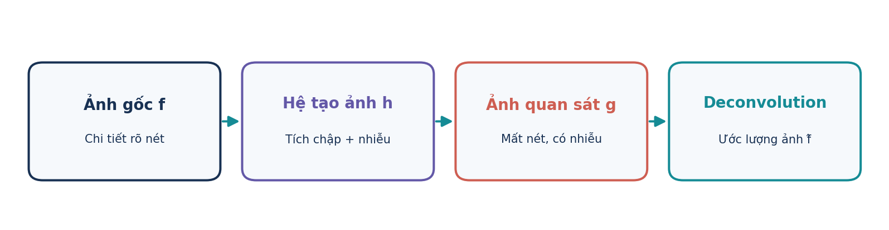

*Hình mở đầu. Tư duy tổng quát về quá trình làm mờ và khôi phục ảnh.*

- **Công cụ nghiên cứu:** DeconvolutionLab2 (EPFL)
- **Đối tượng đọc:** Sinh viên chưa học các thuật toán khôi phục ảnh
- **Ngày biên soạn:** 17/11/2026
- **Thông tin trường, lớp, giảng viên và các thành viên nhóm:** Bổ sung khi nộp.

---

## TÓM TẮT

Báo cáo giới thiệu kỹ thuật khôi phục ảnh Deconvolution từ góc nhìn của người mới bắt đầu. Bài viết giải thích cách máy tính biểu diễn ảnh; vì sao hệ thống chụp ảnh làm nhòe điểm sáng; cách mô hình hóa hiện tượng đó bằng Point Spread Function (PSF), phép tích chập (convolution) và nhiễu; vai trò của biến đổi Fourier trong việc xử lý tích chập và phép toán ngược.

Trên nền tảng ấy, báo cáo lần lượt xây dựng và phân tích bốn nội dung: Naive Inverse Filtering (NIF), Regularization, Tikhonov/Regularized Inverse Filtering (TRIF/RIF), và Richardson–Lucy (RL). Mỗi thuật toán đi từ mục đích, trực giác hoạt động, công thức có giải thích ký hiệu, ví dụ số tính từng bước, điều kiện áp dụng đến hạn chế thường gặp. Phần minh họa sử dụng bộ ảnh tổng hợp có ảnh tham chiếu và một PSF Gaussian để so sánh chất lượng khôi phục bằng PSNR và SSIM. Cuối cùng là hướng dẫn tổ chức thực hành với DeconvolutionLab2, phân biệt minh họa Python và kết quả chạy trực tiếp trên phần mềm.

**Lưu ý về tính trung thực của kết quả:** Tất cả hình ảnh và số liệu ở phần thực nghiệm minh họa trong tài liệu này được tự tạo và tính bằng Python, dùng các công thức tương ứng. Đây **không phải** kết quả được xuất trực tiếp từ DeconvolutionLab2. Hướng dẫn dùng DeconvolutionLab2 được trình bày riêng để nhóm tự thực hiện và chèn bằng chứng thực nghiệm khi nộp.

---

## MỤC TIÊU HỌC TẬP

- Giải thích được vì sao ảnh bị mờ và vai trò của PSF trong mô hình hóa hệ thống tạo ảnh.
- Tự tính được một ví dụ convolution 1D, 2D và hiểu định lý tích chập trong miền Fourier.
- Mô tả được nguyên lý NIF, Regularization, TRIF, RIF và Richardson–Lucy; phân biệt bài toán thuận với bài toán ngược.
- Tự tính được một bước cập nhật Richardson–Lucy và một bài toán Tikhonov đơn giản.
- Biết kiểm tra độ chính xác của thí nghiệm bằng PSNR, SSIM và hiểu giới hạn của hai chỉ số.
- Có quy trình cụ thể để thực hành và so sánh các thuật toán trong DeconvolutionLab2.

## LỘ TRÌNH NỘI DUNG

- Chương 1. Nhập môn ảnh số và bài toán khôi phục ảnh
- Chương 2. PSF, convolution và biến đổi Fourier
- Chương 3. Các thuật toán Deconvolution: NIF, Regularization, TRIF, RIF, RL
- Chương 4. Thực nghiệm minh họa có số liệu định lượng
- Chương 5. Hướng dẫn dùng DeconvolutionLab2 và thiết kế báo cáo nhóm
- Chương 6. Tổng kết và câu hỏi ôn tập
- Phụ lục A–C. Ký hiệu, giả mã, lời giải ví dụ và tài liệu tham khảo

---

## CHƯƠNG 1. NHẬP MÔN ẢNH SỐ VÀ KHÔI PHỤC ẢNH

### 1.1. Vấn đề xuất phát từ thực tế

Một máy ảnh đang chụp bảng chữ: nếu lấy nét sai, nét chữ có thể loang sang các pixel kế bên; nếu tay cầm rung trong lúc phơi sáng, các đường biên kéo dài thành vệt. Với kính hiển vi, ánh sáng phát ra từ một điểm rất nhỏ không được ghi lại thành đúng một điểm vô cùng bé; giới hạn nhiễu xạ khiến nó được ghi nhận như một vùng sáng. Các hiện tượng này làm giảm khả năng quan sát và đo lường. \[1\]

Mục tiêu của khôi phục ảnh (image restoration) là ước lượng hình ảnh ban đầu dựa trên **mô hình của quá trình suy giảm**. Điều này khác với việc tăng độ sắc nét tùy ý: một bộ lọc làm sắc nét có thể khiến biên trông rõ hơn nhưng không nhất thiết tái tạo đúng thông tin vật lý đã bị mờ.

### 1.2. Ảnh số là một ma trận

Một ảnh xám được mô tả bằng hàm $f(x, y)$, trong đó $x$ và $y$ là vị trí pixel, còn $f(x, y)$ là cường độ sáng. Với ảnh 8-bit, giá trị thường nằm từ 0 (đen) đến 255 (trắng). Trong các công thức và thí nghiệm dưới đây, ta thường chuẩn hóa ảnh thành khoảng $[0, 1]$ để thao tác thuận tiện.

Ví dụ, ma trận ảnh $3 \times 3$ gồm một điểm sáng ở giữa có thể viết:

$$
F = \begin{bmatrix} 0 & 0 & 0 \\ 0 & 9 & 0 \\ 0 & 0 & 0 \end{bmatrix} \qquad (1)
$$

Ta sẽ sử dụng đúng ma trận này ở chương 2 để quan sát cách một điểm sáng bị PSF phân tán lên các pixel lân cận.

### 1.3. Bài toán thuận và bài toán ngược

Bài toán thuận: biết ảnh gốc $f$ và đặc tính làm mờ $h$, tính ảnh quan sát $g$. Bài toán ngược: biết ảnh quan sát $g$ cùng với thông tin về $h$, tìm $f$. Bài toán ngược thường khó vì nhiễu và vì có những thành phần thông tin bị làm mờ mạnh đến mức rất khó nhận biết lại.

$$
g(x, y) = (f * h)(x, y) + n(x, y) \qquad (2)
$$

Các ký hiệu: $f$ là ảnh gốc; $h$ là PSF; $g$ là ảnh bị suy giảm; $n$ là nhiễu; dấu $*$ là tích chập. Trong ký hiệu ma trận, công thức trở thành **$g = Hf + n$**, với $H$ là toán tử làm mờ. Đây là mô hình tuyến tính, bất biến theo vị trí và cộng nhiễu, dùng để giới thiệu; nó không mô tả mọi loại ảnh trong thực tế. \[1\]

### 1.4. Nhiễu khác làm mờ như thế nào?

| **Đặc điểm** | **Làm mờ (blur)** | **Nhiễu (noise)** |
| --- | --- | --- |
| Hình dung | Điểm sáng loang thành vùng, biên bị nhòe | Pixel biến thiên ngẫu nhiên hoặc do hệ đo |
| Mô hình cơ bản | Tích chập ảnh với PSF | Cộng nhiễu hoặc mô hình photon Poisson |
| Vấn đề khi khôi phục | Mất/giảm thông tin tần số | Nhiễu có thể bị khuếch đại lên |
| Gợi ý xử lý | Biết hoặc ước lượng PSF | Chọn mô hình nhiễu và điều chuẩn phù hợp |

Trong ảnh photon, một mô hình phổ biến là nhiễu Poisson, phản ánh tính ngẫu nhiên của việc đếm photon. Còn mô hình cộng nhiễu Gaussian có ích khi giải thích nhiều thuật toán bình phương tối thiểu như Tikhonov. \[1\]

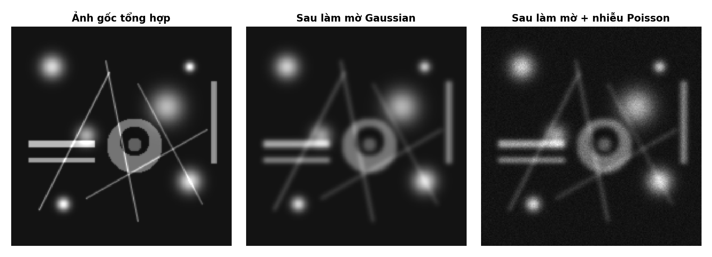

*Hình 1.1. Ảnh tổng hợp tạo cho báo cáo: từ ảnh gốc qua Gaussian blur đến ảnh quan sát có thêm nhiễu Poisson.*

---

## CHƯƠNG 2. PSF, TÍCH CHẬP VÀ BIẾN ĐỔI FOURIER

### 2.1. PSF: một điểm sáng sẽ trông như thế nào?

PSF (Point Spread Function, hàm lan truyền điểm) là hình ảnh mà hệ thu nhận tạo ra khi quan sát một nguồn sáng lý tưởng rất nhỏ. Nếu hệ ghi nhận hoàn hảo, năng lượng chỉ nằm tại một pixel; nếu hệ gây mờ, cường độ bị dàn sang các pixel lân cận. Do mọi điểm trong ảnh đều chịu hiệu ứng tương tự (khi PSF không thay đổi theo vị trí), có thể mô tả toàn bộ ảnh mờ bằng tích chập với PSF. \[1\]

Một mô hình dễ tiếp cận là PSF Gaussian hai chiều:

$$
h(x, y) = \frac{1}{2\pi\sigma^2} \exp\left(-\frac{x^2 + y^2}{2\sigma^2}\right) \qquad (3)
$$

Ý nghĩa: $x, y$ đo khoảng cách từ tâm; $\sigma$ (sigma) điều khiển độ rộng của vùng sáng. $\sigma$ lớn hơn thường tạo mức độ mờ cao hơn. Với PSF rời rạc, các phần tử được chuẩn hóa để **tổng bằng 1**, giúp bảo toàn tổng cường độ trong mô hình không mất sáng.

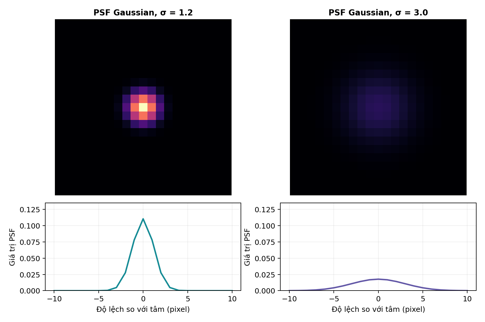

*Hình 2.1. Hai PSF Gaussian được tạo cho báo cáo: $\sigma = 1,2$ và $\sigma = 3,0$ pixel; hàng dưới là lát cắt qua tâm.*

Trong kính hiển vi, PSF thực tế có thể khác Gaussian; có thể đo PSF bằng ảnh hạt huỳnh quang nhỏ hoặc tính từ mô hình vật lý quang học. Việc chọn PSF không phù hợp dẫn tới ringing, chi tiết giả hoặc khôi phục kém chính xác. \[1\], \[2\]

### 2.2. Convolution: lấy trung bình có trọng số

Phép tích chập hai chiều rời rạc được mô tả bằng:

$$
(f * h)[m, n] = \sum_{i} \sum_{j} f[i, j] h[m - i, n - j] \qquad (4)
$$

Để hiểu công thức, hãy lấy từng giá trị của $h$ làm trọng số cho các pixel trong vùng gần vị trí đang xét. Khi kernel $h$ có nhiều trọng số dương, ảnh đầu ra tại một điểm là tổ hợp từ các pixel lân cận. Tích chập đúng nghĩa có thao tác đảo chiều kernel; với kernel đối xứng như Gaussian và trung bình, kết quả không đổi so với tương quan chéo.

### 2.3. Ví dụ tính toán 1D – bắt đầu từ 5 con số

Giả sử tín hiệu 1D có một điểm sáng cường độ 8 nằm ở giữa: **$f = [0, 0, 8, 0, 0]$**. Dùng kernel $h = [0,25;\ 0,50;\ 0,25]$. Ở mỗi vị trí, ta lấy 25% pixel bên trái + 50% pixel giữa + 25% pixel bên phải (giả sử ngoài biên là 0).

Tại tâm: $g[2] = 0,25 \times 0 + 0,50 \times 8 + 0,25 \times 0 = \mathbf{4}$. Tại bên trái: $g[1] = 0,25 \times 0 + 0,50 \times 0 + 0,25 \times 8 = \mathbf{2}$. Tại bên phải: $g[3] = 0,25 \times 8 + 0,50 \times 0 + 0,25 \times 0 = \mathbf{2}$.

$$
[0, 0, 8, 0, 0] * [0.25, 0.5, 0.25] = [0, 2, 4, 2, 0] \qquad (5)
$$

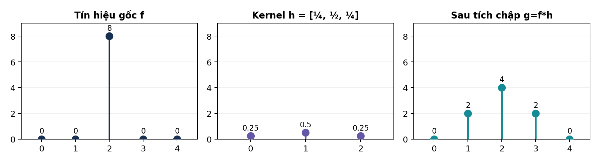

*Hình 2.2. Tích chập 1D: một đỉnh sáng cao 8 bị phân tán thành ba giá trị 2 – 4 – 2.*

Nhận xét: tổng cường độ vẫn bằng 8 nhưng điểm sáng không còn tập trung ở vị trí ban đầu. Đây là lý do đường biên và các cấu trúc nhỏ nhìn kém sắc nét.

### 2.4. Ví dụ tính toán 2D – kernel trung bình 3 × 3

Xét ảnh $5 \times 5$ chỉ có pixel tâm bằng 9, các điểm khác bằng 0. Chọn kernel $3 \times 3$ với mỗi phần tử bằng $1/9$. Ở 9 vị trí có vùng lân cận chứa pixel sáng, kết quả mỗi vị trí đều bằng $9 \times (1/9) = 1$; các vị trí khác bằng 0. Tổng cường độ vẫn bằng 9 nếu không bị cắt biên.

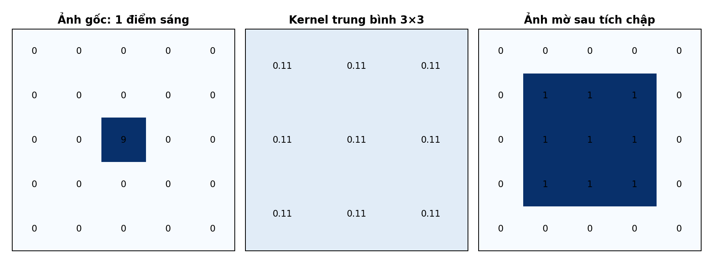

*Hình 2.3. Ví dụ convolution 2D: một điểm sáng giá trị 9 biến thành vùng $3 \times 3$ gồm chín giá trị 1.*

**Điểm dễ nhầm:** Convolution là phép làm mờ theo mô hình đã biết; Deconvolution là cố gắng giải quá trình ngược. Phép ngược không thể luôn thực hiện bằng cách đổi dấu, đảo kernel hay chia trực tiếp từng pixel.

### 2.5. Biến đổi Fourier giúp gì?

Một ảnh có thể được xem dưới hai cách biểu diễn: miền không gian (các pixel ở vị trí $x, y$) và miền tần số (các thành phần dao động theo không gian). Thành phần tần số thấp liên quan các vùng thay đổi sáng chậm; tần số cao thường liên quan biên và chi tiết nhỏ.

Biến đổi Fourier rời rạc 2D của ảnh kích thước $M \times N$ là:

$$
F[u, v] = \sum_{x=0}^{M-1} \sum_{y=0}^{N-1} f[x, y] e^{-j 2\pi (ux/M + vy/N)} \qquad (6)
$$

Trong đó $j^2 = -1$; $(u, v)$ là tọa độ trong miền tần số. Không cần ghi nhớ ngay công thức mũ phức: ý nghĩa chủ yếu là phép biến đổi tách ảnh thành các thành phần tần số. FFT là thuật toán tính DFT hiệu quả, không phải một phép biến đổi khác.

### 2.6. Định lý tích chập và ví dụ mất thông tin

Với tích chập vòng hoặc phép xử lý biên và đệm dữ liệu phù hợp, ta có định lý:

$$
G[u, v] = H[u, v] F[u, v] + N[u, v] \qquad (7)
$$

Vì vậy phép tích chập phức tạp trong không gian có thể được thay bằng phép nhân theo từng hệ số tần số. Nhưng bài toán ngược trở nên khó khi $H[u, v]$ nhỏ hoặc bằng 0.

**Ví dụ chỉ có 2 pixel:** giả sử kernel làm mờ tuần hoàn $h = [1/2, 1/2]$. DFT hai điểm của $h$ là $H = [1, 0]$. Thành phần tần số thứ hai đã mất hoàn toàn. Hai ảnh có cùng trung bình nhưng khác độ tương phản có thể tạo ra ảnh bị mờ giống nhau; không có phép chia nào khôi phục chắc chắn thông tin đã mất.

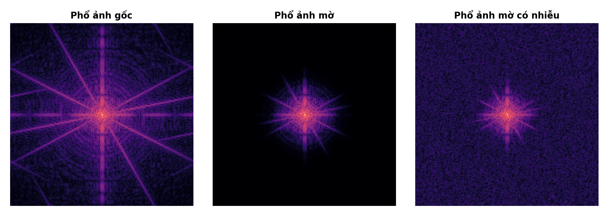

*Hình 2.4. Phổ Fourier (độ lớn logarit) của ảnh tổng hợp: làm mờ làm yếu bớt nhiều thành phần cao tần, trong khi nhiễu làm thay đổi phổ.*

### 2.7. Các giả thiết kỹ thuật thường bị bỏ quên

- **Điều kiện biên:** đệm ảnh bằng 0, phản xạ hay dùng tích chập vòng cho kết quả khác nhau ở rìa ảnh. FFT thuận tiện nhưng có thể gây “quấn ảnh” nếu đệm không phù hợp.
- **Chuẩn hóa PSF:** tổng PSF nên được kiểm tra; PSF bị lệch tâm có thể làm ảnh kết quả bị dịch vị trí.
- **Đơn vị pixel:** khi ảnh và PSF có kích thước pixel khác nhau, mô hình dễ sai.
- **Dữ liệu 2D và 3D:** với ảnh chồng lớp (z-stack), PSF và tích chập có thể là ba chiều; báo cáo dùng ảnh 2D để giải thích toán học nhưng phần mềm hỗ trợ 3D.

---

## CHƯƠNG 3. CÁC THUẬT TOÁN DECONVOLUTION

### 3.1. Vì sao khử mờ là bài toán ngược không ổn định?

Một bài toán được gọi là không ổn định khi dữ liệu thay đổi rất ít nhưng kết quả ước lượng có thể thay đổi rất nhiều. Trong deconvolution, một thành phần tín hiệu từng bị làm suy giảm 100 hoặc 1.000 lần cần được khuếch đại ngược để khôi phục. Nhiễu đi kèm cũng bị khuếch đại như vậy. Đây là lý do ảnh sắc hơn chưa chắc đúng hơn. \[1\], \[5\]

### 3.2. Naive Inverse Filtering (NIF) – lọc ngược trực tiếp

**Tư tưởng:** nếu ảnh mờ trong miền Fourier được tạo bởi phép nhân $F \cdot H$, hãy khôi phục $F$ bằng phép chia $G / H$. Bỏ qua nhiễu, công thức là:

$$
\widehat{F}[u, v] = \frac{G[u, v]}{H[u, v]} \qquad (8)
$$

Nếu $H$ bằng 0 thì phép chia không xác định. Cách triển khai thực tế có thể dùng ngưỡng $\varepsilon$ để tránh tràn số; tuy nhiên ngưỡng không giải quyết được bản chất khuếch đại nhiễu. Phương pháp NIF trong DeconvolutionLab2 được giới thiệu ở mục 3.2 bài báo gốc. \[1\]

#### 3.2.1. Ví dụ số: khi chia cho hệ số rất nhỏ

Giả sử hệ số tần số thật $F = 4$ và hệ thống làm suy giảm với $H = 0,01$. Khi không có nhiễu, $G = 4 \times 0,01 = 0,04$; chia $0,04 / 0,01$ ta khôi phục đúng 4. Nhưng nếu có nhiễu $+0,02$, máy đo thu $G = 0,06$ và phép chia trả về $0,06 / 0,01 = \mathbf{6}$, sai 50% so với giá trị thật. Nếu $H$ nhỏ hơn nữa thì sai số càng nghiêm trọng.

#### 3.2.2. Ví dụ ma trận 2 × 2

Cho ảnh gốc theo hai pixel $f = [8, 0]^T$ và một bộ làm mờ có ma trận $H$ bên dưới (mỗi hàng có tổng bằng 1). Khi đó $g = Hf = [6, 2]^T$: một phần ánh sáng từ pixel đầu chuyển sang pixel sau.

$$
H = \begin{bmatrix} 0.75 & 0.25 \\ 0.25 & 0.75 \end{bmatrix}, \qquad H \begin{bmatrix} 8 \\ 0 \end{bmatrix} = \begin{bmatrix} 6 \\ 2 \end{bmatrix} \qquad (9)
$$

Vì $H$ khả nghịch, $H^{-1}g = [8, 0]^T$. Nhưng nếu dữ liệu quan sát thành $[6,1;\ 1,9]^T$ do nhiễu $\pm 0,1$ thì kết quả lọc ngược là **$[8,2;\ -0,2]^T$**. Giá trị âm không phù hợp nếu dữ liệu là cường độ sáng; ảnh hưởng của nhiễu đã tăng lên.

#### 3.2.3. Khi nào nên dùng NIF?

- Dùng để học nguyên lý và làm mốc so sánh cơ bản.
- Có thể phù hợp khi nhiễu rất thấp và PSF không gây suy giảm tần số nghiêm trọng.
- Không nên mặc định dùng cho ảnh thật có nhiễu đáng kể.

### 3.3. Regularization – thêm “quy tắc” để nghiệm ổn định

Nếu chỉ cố gắng làm cho ảnh phục hồi, sau khi bị làm mờ lại, khớp tuyệt đối với ảnh quan sát, thuật toán có thể học cả nhiễu. Regularization (điều chuẩn) chấp nhận một mức sai số vừa phải để đổi lấy nghiệm ổn định hoặc hợp lý hơn theo tiêu chí đã chọn.

$$
\widehat{f} = \arg\min_{f} \left\{ \|Hf - g\|_2^2 + \lambda R(f) \right\} \qquad (10)
$$

Hàm mục tiêu có hai phần: (1) **độ khớp dữ liệu** $\|Hf - g\|_2^2$ – càng nhỏ càng khớp; (2) **mức phạt** $R(f)$ – khuyến khích nghiệm có tính chất mong muốn. Tham số $\lambda \ge 0$ quyết định ta đánh đổi hai điều kiện đó như thế nào. Không có một $\lambda$ phù hợp cho tất cả ảnh.

**Ví dụ đời thường:** chụp một hình tròn bị mờ và nhiễu. Nếu cố giải thích từng đốm nhiễu như chi tiết thật, đường tròn có thể xuất hiện nhiều gai nhọn. Điều chuẩn giống như một quy tắc “đừng tạo dao động quá mạnh nếu dữ liệu chưa đủ chắc chắn”.

### 3.4. Tikhonov (TRIF) – điều chuẩn bằng bình phương độ lớn nghiệm

Tikhonov bậc không dùng $R(f) = \|f\|_2^2$. Khi đó:

$$
\widehat{f} = \arg\min_{f} \left( \|Hf - g\|_2^2 + \lambda \|f\|_2^2 \right) \qquad (11)
$$

Cực tiểu của hàm trên trong bài toán tuyến tính có dạng:

$$
\widehat{f} = (H^T H + \lambda I)^{-1} H^T g \qquad (12)
$$

Với PSF và điều kiện biên cho phép chéo hóa bằng DFT, ta có công thức miền Fourier:

$$
\widehat{F} = \frac{H^* G}{|H|^2 + \lambda} \qquad (13)
$$

Dấu $*$ trên $H$ là liên hợp phức, không phải phép tích chập. Mẫu số có thêm $\lambda$ nên không bị chia cho các giá trị $|H|^2$ quá nhỏ như trong lọc ngược đơn giản. \[1\]

#### 3.4.1. Ví dụ Tikhonov một chiều tính đến kết quả

Giả sử giá trị cần khôi phục thật là $f = 4$. Hệ thống suy giảm theo hệ số $H = 0,1$ nên tín hiệu không nhiễu sẽ là $0,4$. Do sai số đo $+0,05$, dữ liệu thu được $g = 0,45$. Với lọc ngược, $\widehat{f} = 0,45 / 0,1 = \mathbf{4,5}$. Với Tikhonov một chiều:

$$
\widehat{f}_\lambda = \frac{Hg}{H^2 + \lambda} = \frac{0.045}{0.01 + \lambda} \qquad (14)
$$

| **$\lambda$** | **Kết quả $\widehat{f}$** | **Sai số so với $f = 4$** | **Ý nghĩa** |
| --- | --- | --- | --- |
| 0 (lọc ngược) | 4,5000 | 0,5000 | Khuếch đại sai số đo |
| 0,001 | 4,0909 | 0,0909 | Cân bằng tốt trong ví dụ này |
| 0,01 | 2,2500 | 1,7500 | Điều chuẩn quá mạnh, ước lượng lệch nhiều |

Ví dụ cho thấy $\lambda$ không chỉ “càng lớn càng tốt”. Khi tăng $\lambda$, ảnh có thể ổn định hơn trước nhiễu, nhưng mức thiên lệch (bias) cũng tăng. Việc chọn $\lambda$ cần dựa trên đặc điểm PSF, nhiễu và mục tiêu sử dụng.

### 3.5. Regularized Inverse Filter (RIF) – phạt thay đổi cục bộ

DeconvolutionLab2 phân biệt TRIF với RIF. Trong bài báo Sage và cộng sự, RIF dùng điều chuẩn bằng năng lượng của toán tử Laplacian $L$, nhằm kiểm soát thay đổi cục bộ của ảnh (thay vì phạt trực tiếp độ lớn pixel như TRIF). \[1\]

$$
\widehat{f} = \arg\min_{f} \left( \|Hf - g\|_2^2 + \lambda \|Lf\|_2^2 \right) \qquad (15)
$$

$$
\widehat{f} = (H^T H + \lambda L^T L)^{-1} H^T g \qquad (16)
$$

Một dạng Laplacian rời rạc 2D dùng kernel $3 \times 3$ có tâm $-4$ và bốn lân cận trực tiếp bằng $1$:

$$
L = \begin{bmatrix} 0 & 1 & 0 \\ 1 & -4 & 1 \\ 0 & 1 & 0 \end{bmatrix} \qquad (17)
$$

Ví dụ với vùng có cùng mức xám 5 ở cả năm vị trí tâm và bốn điểm kề, áp dụng Laplacian cho ra $5 + 5 + 5 + 5 - 4 \times 5 = \mathbf{0}$. Nhưng nếu giá trị tâm bằng 9 còn bốn điểm kề bằng 5, kết quả là $20 - 36 = \mathbf{-16}$: vùng biến thiên mạnh bị phạt nhiều hơn khi lấy bình phương.

**Ý nghĩa:** RIF có thể ưu tiên ảnh thay đổi tương đối êm ở nhiều vùng; tuy nhiên điều chuẩn bằng đạo hàm cũng có thể làm yếu biên sắc nếu $\lambda$ quá mạnh. Các loại điều chuẩn khác như Total Variation được thiết kế với mục tiêu giữ biên tốt hơn trong nhiều tình huống.

### 3.6. Richardson–Lucy (RL) – sửa dần qua các vòng lặp

Đây là phương pháp nổi bật khác với họ lọc ngược. Thay vì tìm nghiệm một lần, RL bắt đầu từ một ảnh ước lượng không âm rồi lặp chu trình: làm mờ ảnh ước lượng → so sánh với ảnh đo → truyền hiệu chỉnh ngược qua PSF → cập nhật ảnh. RL thường được xây dựng từ giả thiết quan sát photon theo phân bố Poisson. \[1\], \[3\], \[4\]

Công thức cập nhật chuẩn hóa có thể viết:

$$
f^{(k+1)} = f^{(k)} \odot \left[ h^\star * \frac{g}{h * f^{(k)} + \varepsilon} \right] \qquad (18)
$$

Giải thích: $k$ là chỉ số vòng lặp; $\odot$ là nhân theo từng pixel; $h^\star$ là PSF đảo chiều (toán tử liên hợp của tích chập trong những điều kiện biên thích hợp); dấu chia là chia theo pixel; $\varepsilon$ là số dương nhỏ để tránh chia cho 0. Với PSF được chuẩn hóa phù hợp, công thức có tính trực quan như một tỷ lệ hiệu chỉnh.

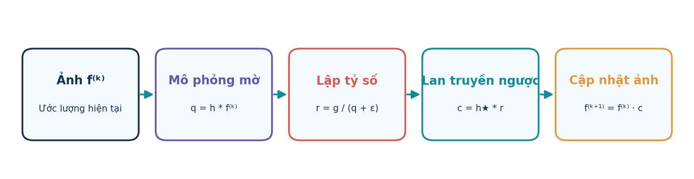

*Hình 3.1. Chu trình Richardson–Lucy: từ ảnh ước lượng, tạo dự đoán, tính tỷ lệ hiệu chỉnh và cập nhật ảnh qua từng vòng lặp.*

1. Chọn ảnh ước lượng ban đầu $f^{(0)}$ không âm, ví dụ ảnh phẳng hoặc chính ảnh quan sát.
2. Tính ảnh dự đoán $q = h * f^{(k)}$.
3. Lấy tỷ lệ hiệu chỉnh $r = g / (q + \varepsilon)$. Tỷ lệ $> 1$ gợi ý ảnh dự đoán đang thiếu cường độ tại vị trí đó.
4. Tích chập tỷ lệ $r$ với PSF đảo chiều để phân phối hiệu chỉnh về vị trí nguồn.
5. Nhân kết quả hiệu chỉnh với $f^{(k)}$ để được $f^{(k+1)}$, lặp lại nếu cần.

#### 3.6.1. Bài toán RL hai pixel: tính hai vòng lặp

Để tự tay kiểm tra thuật toán, dùng cùng ma trận $H$ ở ví dụ NIF: $H = [[0,75;\ 0,25],\ [0,25;\ 0,75]]$, $g = [6, 2]^T$. Giả sử $f^{(0)} = [4, 4]^T$. Vì $H$ có tổng từng hàng bằng 1, ảnh dự đoán là $Hf^{(0)} = [4, 4]^T$.

**Vòng 1:** tỷ lệ $g / (Hf^{(0)}) = [6/4,\ 2/4]^T = [1,5;\ 0,5]^T$. Hiệu chỉnh bằng $H^T$: $H^T [1,5;\ 0,5]^T = [1,25;\ 0,75]^T$. Nhân theo phần tử với $f^{(0)}$ cho:

$$
f^{(1)} = [4, 4]^T \odot [1.25, 0.75]^T = [5, 3]^T \qquad (19)
$$

**Vòng 2:** ảnh dự đoán $H[5, 3]^T = [4,5;\ 3,5]^T$; tỷ lệ $[6/4,5;\ 2/3,5]^T \approx [1,3333;\ 0,5714]^T$. Sau nhân $H^T$ ta được $\approx [1,1429;\ 0,7619]^T$, nên:

$$
f^{(2)} \approx [5, 3]^T \odot [1.1429, 0.7619]^T = [5.7143, 2.2857]^T \qquad (20)
$$

Ảnh thật trong ví dụ là $[8, 0]^T$. Các bước lặp đầu dịch dần cường độ về pixel đầu tiên. Tuy nhiên, với ảnh thật có nhiễu, không nên cho rằng lặp càng lâu càng đúng: nhiễu có thể bị khuếch đại ở các vòng muộn.

#### 3.6.2. Số vòng lặp và điều kiện dừng

Ba cách lựa chọn điểm dừng: (a) đặt trước số vòng lặp và quan sát thay đổi; (b) dừng khi sai khác giữa hai lần ước lượng đủ nhỏ; (c) dùng tiêu chí chất lượng/kiểm định dữ liệu khi có ảnh tham chiếu. Trong thực tế không có ảnh gốc, việc chọn số vòng lặp phải dựa trên mô hình nhiễu, quan sát artifact và mục tiêu phân tích. \[1\]

### 3.7. Richardson–Lucy với điều chuẩn Total Variation (RLTV)

RLTV kết hợp ý tưởng cập nhật RL với một khoản phạt Total Variation (TV). TV đo tổng mức thay đổi cường độ giữa các vị trí lân cận; nó thường cho phép giữ các vùng tương đối phẳng mà không bắt buộc làm mờ tất cả đường biên giống điều chuẩn bình phương đạo hàm.

$$
TV(f) = \sum_{x, y} \sqrt{(\nabla_x f)^2 + (\nabla_y f)^2 + \delta^2} \qquad (21)
$$

Ở đây $\nabla_x$ và $\nabla_y$ là sai phân theo hai trục, $\delta > 0$ giúp biểu thức ổn định. RLTV bổ sung tham số điều chuẩn $\lambda$ bên cạnh số vòng lặp. Báo cáo chỉ giới thiệu nguyên tắc; để lập trình chính xác cần tuân theo dạng cập nhật và ràng buộc trong tài liệu gốc. \[1\]

### 3.8. Tóm tắt so sánh theo bản chất toán học

| **Thuật toán** | **Giả thiết/tiêu chí** | **Cơ chế** | **Điều phải điều chỉnh** |
| --- | --- | --- | --- |
| NIF | Giải ngược tuyến tính ít điều chuẩn | Phân chia trong miền Fourier | Xử lý hệ số $H$ nhỏ, điều kiện biên |
| TRIF | Bình phương tối thiểu + $\lambda\|f\|^2$ | Nghiệm đóng, miền Fourier | $\lambda$ |
| RIF | Bình phương tối thiểu + $\lambda\|Lf\|^2$ | Phạt độ cong/đạo hàm cục bộ | $\lambda$ và $L$ |
| RL | Tối đa khả năng Poisson | Ước lượng lặp nhân | Số vòng lặp |
| RLTV | RL + TV | Lặp có điều chuẩn giữ biên | Số vòng lặp + $\lambda$ |

---

## CHƯƠNG 4. THỰC NGHIỆM MINH HỌA VÀ ĐÁNH GIÁ

### 4.1. Thiết kế bài thử có kiểm soát

Để người đọc hiểu thuật toán qua hình ảnh thật sự và kiểm tra được các số liệu, báo cáo tự tạo một ảnh xám tổng hợp $192 \times 192$ pixel với các điểm sáng, đường thẳng, thanh sáng và vùng hình vòng. Ảnh được chuẩn hóa từ 0 đến 1. Dùng PSF Gaussian $17 \times 17$, $\sigma = 1,9$ pixel, tổng PSF = 1; tiến hành tích chập vòng bằng FFT, sau đó thêm nhiễu Poisson với cường độ trung bình tương ứng 700 photon cho mức 1. Bộ sinh số ngẫu nhiên có seed cố định `20261117`.

Các phép khôi phục dùng **chính xác cùng một ảnh quan sát và PSF**. NIF sử dụng ngưỡng cho mẫu số $|H|^2$ là $10^{-4}$ để tránh lỗi số; TRIF dùng $\lambda = 0,02$; RIF dùng $\lambda = 0,005$; RL dùng 20 vòng lặp, ảnh ban đầu phẳng bằng trung bình ảnh quan sát. Kết quả hiển thị và chấm điểm được giới hạn về khoảng $[0, 1]$. Các tham số này phục vụ minh họa, không phải bộ tham số tối ưu cho mọi dữ liệu.

**Phân biệt:** Phần 4 là phép mô phỏng do báo cáo tự tính bằng Python/NumPy/SciPy, công thức tương ứng với các phương pháp của DeconvolutionLab2. Phần mềm DeconvolutionLab2 có thể áp dụng lựa chọn biên, chuẩn hóa, ràng buộc và chi tiết triển khai khác, nên kết quả có thể khác dù chọn tên thuật toán giống nhau.

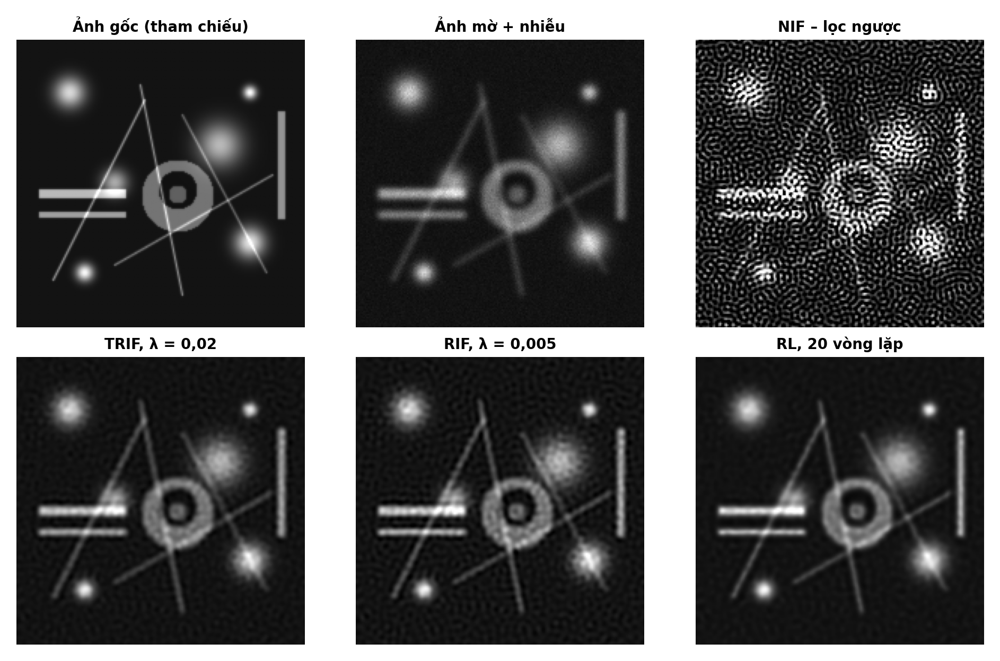

*Hình 4.1. So sánh trực quan cùng một ảnh và PSF: ảnh tham chiếu, ảnh quan sát, NIF, TRIF, RIF và RL (mô phỏng Python tự tạo).*

### 4.2. PSNR và SSIM được tính như thế nào?

Để đo chất lượng khi có ảnh gốc tham chiếu, có thể dùng sai số bình phương trung bình (MSE), PSNR và SSIM. Với $N$ pixel, ảnh gốc $f$ và ảnh khôi phục $\widehat{f}$:

$$
MSE = \frac{1}{N} \sum_{i=1}^{N} (f_i - \widehat{f}_i)^2 \qquad (22)
$$

$$
PSNR = 10 \log_{10} \left( \frac{MAX^2}{MSE} \right) \qquad (23)
$$

$MAX = 1$ với ảnh chuẩn hóa $[0, 1]$; PSNR càng cao thường càng gần ảnh tham chiếu xét theo MSE. **Ví dụ:** nếu $MSE = 0,01$, $PSNR = 10 \cdot \log_{10}(1 / 0,01) = \mathbf{20\text{ dB}}$. Nếu $MSE = 0,001$ thì $PSNR = \mathbf{30\text{ dB}}$ (tăng 10 dB tương ứng MSE giảm 10 lần).

SSIM (Structural Similarity Index) so sánh các yếu tố sáng, tương phản và cấu trúc; trong cách dùng thông thường với ảnh này, SSIM càng gần 1 càng tương đồng hơn với ảnh gốc. Công thức một cửa sổ ảnh là:

$$
SSIM(x, y) = \frac{(2\mu_x\mu_y + C_1)(2\sigma_{xy} + C_2)}{(\mu_x^2 + \mu_y^2 + C_1)(\sigma_x^2 + \sigma_y^2 + C_2)} \qquad (24)
$$

Trong đó $\mu$ là trung bình, $\sigma^2$ là phương sai, $\sigma_{xy}$ là hiệp phương sai; $C_1, C_2$ là các hằng số ổn định. SSIM được giới thiệu bởi Wang và cộng sự (2004), có cách tính chuẩn trong scikit-image. \[6\], \[8\]

### 4.3. Kết quả định lượng của đúng mô phỏng trên

| **Phương pháp** | **PSNR (dB)** | **SSIM** | **Nguồn dữ liệu** |
| --- | --- | --- | --- |
| Ảnh quan sát | 25.879 | 0.8206 | Mô phỏng Python |
| NIF | 13.145 | 0.1001 | Mô phỏng Python |
| TRIF, $\lambda = 0,02$ | 28.507 | 0.8586 | Mô phỏng Python |
| RIF, $\lambda = 0,005$ | 28.256 | 0.7867 | Mô phỏng Python |
| RL, 20 vòng | 28.940 | 0.8990 | Mô phỏng Python |

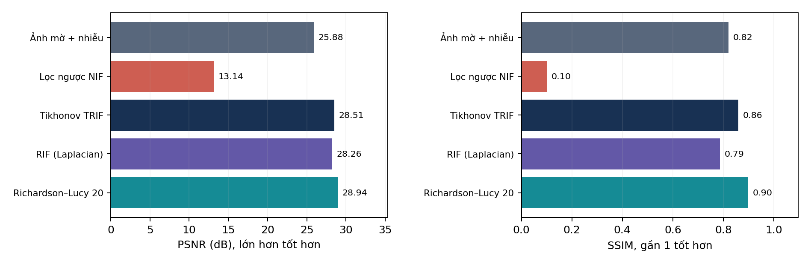

*Hình 4.2. PSNR và SSIM tính từ các ảnh hiển thị ở Hình 4.1 (cùng một dữ liệu tổng hợp).*

**Đọc kết quả:** với bộ ảnh tổng hợp này, RL sau 20 vòng đạt PSNR và SSIM cao nhất trong các cấu hình đã thử. NIF cho chất lượng rất thấp vì làm nhiễu nổi bật. TRIF và RIF cải thiện PSNR so với ảnh quan sát, nhưng mức cải thiện SSIM không giống nhau. Đây là kết quả của một tình huống cụ thể, không chứng minh RL luôn tốt hơn mọi thuật toán khác.

### 4.4. Quan sát RL theo số vòng lặp

Để thấy rõ tính chất “lặp và hiệu chỉnh”, cùng một ảnh đã được khôi phục với số vòng lặp khác nhau. Hình dưới thể hiện ảnh quan sát và các kết quả tại 1, 5, 20, 60 vòng; đồ thị kế tiếp biểu diễn PSNR tính ở những mốc đã chọn.

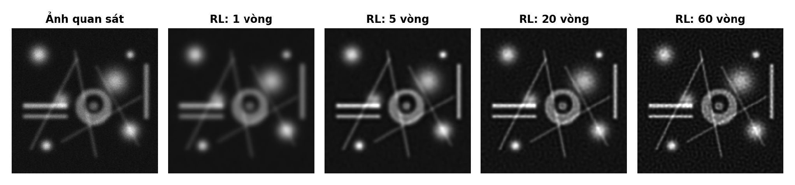

*Hình 4.3. Tiến trình khôi phục Richardson–Lucy theo số vòng lặp (ảnh tổng hợp, cùng thang hiển thị 0–1).*

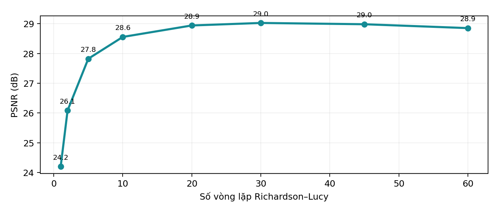

*Hình 4.4. Quan hệ PSNR – số vòng lặp trong bộ mô phỏng hiện tại; đồ thị không khái quát cho mọi bộ ảnh.*

PSNR có thể tăng rồi giảm khi lặp tiếp do nhiễu trở nên rõ hơn; ở một số bài toán khác, đỉnh PSNR xuất hiện tại vòng khác. Vì vậy cần ghi số vòng lặp trong báo cáo và kiểm tra chất lượng, không chỉ dựa vào cảm giác ảnh “sắc hơn”.

### 4.5. Điều gì mô phỏng này chưa chứng minh?

- Ảnh là **dữ liệu tổng hợp 2D**, chưa phải ảnh kính hiển vi thực hoặc stack 3D; PSF Gaussian chưa thể hiện đầy đủ quang sai và nhiễu xạ.
- Dữ liệu mô phỏng dùng nhiễu Poisson; TRIF/RIF theo bình phương tối thiểu không phải mô hình tối đa khả năng Poisson thuần túy.
- Chỉ dùng một bộ ảnh, một PSF và một nhóm tham số nên không đủ xếp hạng tổng quát các thuật toán.
- Kết quả so sánh chỉ dùng phép cắt $[0, 1]$ cho đo PSNR/SSIM; trong ảnh khoa học, cắt giá trị có thể ảnh hưởng diễn giải định lượng.
- Muốn báo cáo kết quả **thực thi DeconvolutionLab2**, cần chạy trên plugin và lưu ảnh đầu ra, tham số, nhật ký và ảnh chụp giao diện của đúng phiên chạy đó.

---

## CHƯƠNG 5. THỰC HÀNH VỚI DECONVOLUTIONLAB2

### 5.1. Giới thiệu phần mềm

DeconvolutionLab2 là công cụ mã nguồn mở của Biomedical Imaging Group tại EPFL, dùng cho bài toán khử mờ ảnh kính hiển vi (đặc biệt dữ liệu ba chiều). Phần mềm có thể liên kết với ImageJ, Fiji, Icy, Matlab hoặc chạy độc lập. Trang chính thức liệt kê NIF, RIF, TRIF, RL, RLTV và nhiều thuật toán khác. \[1\], \[2\]

Trang chính thức: https://bigwww.epfl.ch/deconvolution/deconvolutionlab2/ . Tại thời điểm kiểm tra nguồn, trang này có gói JAR và mô tả cài đặt bằng cách đưa JAR vào thư mục plugins của ImageJ/Fiji rồi khởi động lại. Mục Plugins → DeconvolutionLab2 cung cấp giao diện thao tác. \[2\]

### 5.2. Chuẩn bị dữ liệu đầu vào

1. Chọn ảnh đầu vào: ảnh 2D hoặc một chồng ảnh z-stack có định dạng mà phần mềm hỗ trợ.
2. Chuẩn bị PSF tương ứng: đo từ hạt sáng, sử dụng PSF lý thuyết hoặc bộ dữ liệu mẫu đi kèm.
3. Kiểm tra kích thước voxel/pixel, chuẩn hóa PSF, vị trí tâm PSF và dữ liệu âm/nền.
4. Ghi lại loại nhiễu giả định, mục tiêu so sánh và phương pháp đánh giá trước khi chạy thuật toán.

Với người mới học, nguồn mẫu chính thức trên trang EPFL gồm: “Naive deconvolution” (mô phỏng 2D), “Hollow bars” (ảnh tham chiếu 3D, ảnh suy giảm và PSF), “Drosophila crop” (ảnh sinh học 3D và PSF lý thuyết). Các gói được liệt kê và dẫn liên kết tải ở cuối trang \[2\].

### 5.3. Các bước thao tác đề nghị

1. Khởi động Fiji hoặc ImageJ; mở DeconvolutionLab2 từ menu Plugins.
2. Chọn mục Image và nhập ảnh quan sát cần khôi phục.
3. Chọn mục PSF và nhập PSF tương ứng, hoặc tạo PSF tổng hợp để luyện tập.
4. Chọn mục Algorithm: bắt đầu NIF để hiểu rủi ro, rồi TRIF/RIF với $\lambda$, sau đó RL với số vòng lặp xác định.
5. Thiết lập đầu ra (Output), thư mục lưu, điều kiện đệm biên và chuẩn hóa nếu có.
6. Chạy thuật toán và lưu kết quả của từng cấu hình; không thay đổi dữ liệu gốc giữa các lần chạy.
7. Nếu có ảnh tham chiếu, tính PSNR/SSIM hoặc dùng công cụ đánh giá phù hợp; lập bảng so sánh và rút nhận xét.


*Hình 5.1. Sơ đồ chuẩn bị và thực hiện một bài thử trên DeconvolutionLab2 (sơ đồ tự thiết kế, không phải ảnh chụp giao diện).*

### 5.4. Bảng nhật ký thực nghiệm nên lập

| **Mã chạy** | **Dữ liệu** | **PSF** | **Thuật toán** | **Tham số** | **Đầu ra cần lưu** |
| --- | --- | --- | --- | --- | --- |
| E01 | Hollow Bars | PSF đi kèm | NIF | Ngưỡng ổn định nếu có | TIFF, ghi chú nhiễu |
| E02 | Như E01 | Như E01 | TRIF | $\lambda = \dots$ | TIFF, $\lambda$, PSNR/SSIM |
| E03 | Như E01 | Như E01 | RIF | $\lambda = \dots$ | TIFF, $\lambda$, PSNR/SSIM |
| E04 | Như E01 | Như E01 | RL | 10 / 20 / 40 vòng | TIFF, thời gian, chỉ số |

**Lưu ý:** các dấu “…” ở bảng là giá trị phải chọn và ghi từ thí nghiệm thực tế, không phải số liệu đã được thử trong phần mềm. Nên chụp lại giao diện đã điền tham số khi làm báo cáo nhóm.

### 5.5. Những lỗi phổ biến cần nhận biết

| **Dấu hiệu** | **Nguyên nhân có thể** | **Cách kiểm tra** |
| --- | --- | --- |
| Ảnh có vân sáng-tối quanh biên | Ringing do lọc ngược mạnh hoặc đệm biên | Kiểm tra PSF, $\lambda$, cách padding |
| Ảnh có nhiều chấm sáng lạ | Khuếch đại nhiễu, lặp quá mức | Giảm vòng RL/tăng điều chuẩn phù hợp |
| Ảnh bị nhòe hơn | Điều chuẩn quá mạnh, sai PSF | Khảo sát $\lambda$ và PSF |
| Ảnh bị lệch vị trí | PSF lệch tâm hoặc xử lý biên | Căn tâm PSF, so sánh rìa |
| Không so sánh được chỉ số | Đầu ra khác kích thước hoặc thang đo | Căn chỉnh, chuẩn hóa, dùng cùng ROI |

### 5.6. Đề xuất phân chia công việc trong nhóm

**Thành viên phụ trách lý thuyết** (theo ảnh phân công): rà soát nguồn gốc công thức, kiểm tra ký hiệu, giải thích thuật toán theo ví dụ số, chuẩn bị sơ đồ tư duy và nội dung chương 1–3. **Thành viên thực nghiệm**: cài plugin, lấy ảnh/PSF, chạy ít nhất ba cấu hình có tham số rõ ràng, chụp ảnh và lập bảng kết quả. **Thành viên tổng hợp/thuyết trình**: đối chiếu giả thiết với kết quả, bổ sung số liệu thực chạy, thống nhất trích dẫn và thiết kế phần kết luận.

---

## CHƯƠNG 6. KẾT LUẬN VÀ CÂU HỎI ÔN TẬP

### 6.1. Hệ thống hóa kiến thức

Quá trình khôi phục ảnh bằng Deconvolution bắt đầu từ việc **mô hình hóa đúng cách ảnh được tạo ra**. PSF mô tả cách một điểm sáng bị làm mờ; convolution cho biết hiệu ứng PSF lên toàn ảnh; Fourier biến tích chập thành phép nhân và làm rõ vì sao một số thành phần tín hiệu gần như không thể khôi phục.

NIF sử dụng phép đảo trực tiếp nên rất dễ học nhưng nhạy với nhiễu. Regularization làm bài toán ổn định hơn bằng cách đánh đổi sai số dữ liệu với một tiêu chí bổ sung. TRIF điều chuẩn độ lớn nghiệm, RIF phạt Laplacian; RL đi theo hướng lặp nhân từ mô hình Poisson và có thể dừng sớm để kiểm soát nhiễu. RLTV là hướng mở rộng để cân bằng giữa làm giảm nhiễu và giữ biên.

Bộ ảnh mô phỏng trong báo cáo minh họa trực quan sự khác biệt giữa các phương pháp, nhưng không thay thế kết quả chạy plugin hay kiểm thử trên nhiều điều kiện. Khi nộp báo cáo chính thức, cần bổ sung phần thực nghiệm đúng với phần mềm và bộ dữ liệu mà nhóm thực sự sử dụng.

### 6.2. Bảy câu hỏi tự kiểm tra trước khi thuyết trình

1. **Tại sao ảnh bị mờ?**
   Trả lời: Vì thông tin từ một điểm có thể bị dàn sang vùng lân cận khi thu nhận; nhiễu còn làm giá trị đo sai lệch.
2. **PSF là gì?**
   Trả lời: Đáp ứng của hệ thống đối với một điểm sáng; mô tả phân bố lan tỏa của điểm đó.
3. **Convolution khác Deconvolution ra sao?**
   Trả lời: Convolution dự đoán ảnh mờ từ ảnh gốc và PSF; deconvolution ước lượng ảnh gốc từ ảnh mờ và thông tin PSF.
4. **Tại sao Fourier hữu ích?**
   Trả lời: Vì tích chập trong không gian chuyển thành nhân hệ số trong miền tần số, dễ phân tích và tính nhanh bằng FFT.
5. **NIF có nhược điểm nào quan trọng nhất?**
   Trả lời: Khuếch đại nhiễu khi hệ số tần số $H$ rất nhỏ hoặc bằng 0.
6. **$\lambda$ trong Tikhonov có ý nghĩa gì?**
   Trả lời: Điều chỉnh mức cân bằng giữa khớp ảnh đo và điều chuẩn; quá nhỏ dễ nhiễu, quá lớn dễ mất chi tiết.
7. **Richardson–Lucy khác Tikhonov ở đâu?**
   Trả lời: RL cập nhật lặp, thường dựa trên mô hình Poisson; Tikhonov trong dạng trình bày dùng bình phương tối thiểu với điều chuẩn và có nghiệm đóng.

---

## PHỤ LỤC A. BẢNG KÝ HIỆU

| **Ký hiệu** | **Diễn giải** | **Ghi chú** |
| --- | --- | --- |
| $f$ / $\widehat{f}$ | Ảnh gốc / ảnh khôi phục | Mảng pixel hoặc vector |
| $g$ | Ảnh quan sát bị mờ/nhiễu | Dữ liệu đầu vào |
| $h$ / $H$ | PSF / toán tử ma trận làm mờ | Có thể là 2D hoặc 3D |
| $n$ | Nhiễu | Poisson hoặc cộng Gaussian tùy mô hình |
| $*$ / $\odot$ | Tích chập / nhân theo pixel | Không được nhầm hai phép |
| $F, G, H$ (Fourier) | Các phổ tần số tương ứng | $H(u, v)$ không phải $H$ ma trận |
| $\lambda$ | Tham số điều chuẩn | Lựa chọn theo dữ liệu |
| $L$ | Toán tử Laplacian | Được dùng trong RIF |
| $k$ | Chỉ số vòng lặp | Ví dụ RL $k = 0, 1, 2\dots$ |
| MSE, PSNR, SSIM | Chỉ số đánh giá chất lượng | Thường cần ảnh tham chiếu |

---

## PHỤ LỤC B. GIẢ MÃ VÀ BÀI TẬP MẪU

### B.1. Giả mã của Richardson–Lucy

```text
Input: g >= 0, PSF h >= 0 đã chuẩn hóa, số vòng K.
Khởi tạo f = hằng số dương hoặc một ảnh ước lượng không âm.
Lặp k từ 1 đến K:
    q <- convolution(f, h)
    ratio <- g / max(q, eps)
    correction <- convolution(ratio, h đảo chiều)
    f <- max(f * correction, 0)
Output: ảnh f sau K vòng.
```

### B.2. Bài tập 1: tự tính convolution

Tín hiệu $[0, 0, 12, 0, 0]$ qua kernel $[1/4, 1/2, 1/4]$ theo quy ước như ví dụ chương 2. Kết quả: **$[0, 3, 6, 3, 0]$**. Kiểm tra: tổng đầu vào và đầu ra đều bằng 12.

### B.3. Bài tập 2: nhận biết lọc ngược khuếch đại nhiễu

Một hệ số tần số $F = 5$ bị suy giảm bởi $H = 0,02$. Quan sát không nhiễu sẽ là $0,1$; nếu đo được $0,12$ thì lọc ngược cho $0,12 / 0,02 = \mathbf{6}$. Sai số ảnh phục hồi bằng 1 mặc dù nhiễu đo chỉ là $0,02$.

### B.4. Bài tập 3: tự thay $\lambda$ trong Tikhonov

Với $H = 0,2$, $g = 0,9$ và $\lambda = 0,01$: $\widehat{f} = H \cdot g / (H^2 + \lambda) = 0,18 / (0,04 + 0,01) = \mathbf{3,6}$. Với $\lambda = 0,04$, $\widehat{f} = 0,18 / 0,08 = \mathbf{2,25}$. Chọn $\lambda$ không thể chỉ dựa vào mong muốn “ít nhiễu” mà cần xét cả độ lệch nghiệm.

---

## PHỤ LỤC C. TÀI LIỆU THAM KHẢO

**\[1\]** D. Sage, L. Donati, F. Soulez, D. Fortun, G. Schmit, A. Seitz, R. Guiet, C. Vonesch và M. Unser, “DeconvolutionLab2: An Open-Source Software for Deconvolution Microscopy,” *Methods*, tập 115, tr. 28–41, 2017. DOI: 10.1016/j.ymeth.2016.12.015.
https://bigwww.epfl.ch/publications/sage1701.html

**\[2\]** Biomedical Imaging Group, EPFL, “3D Deconvolution Microscopy — DeconvolutionLab2,” trang phần mềm và học liệu chính thức.
https://bigwww.epfl.ch/deconvolution/deconvolutionlab2/

**\[3\]** W. H. Richardson, “Bayesian-Based Iterative Method of Image Restoration,” *Journal of the Optical Society of America*, tập 62, số 1, tr. 55–59, 1972.
https://doi.org/10.1364/JOSA.62.000055

**\[4\]** L. B. Lucy, “An Iterative Technique for the Rectification of Observed Distributions,” *The Astronomical Journal*, tập 79, tr. 745–754, 1974.
https://doi.org/10.1086/111605

**\[5\]** A. N. Tikhonov, “On the Solution of Ill-Posed Problems and the Method of Regularization,” *Doklady Akademii Nauk SSSR*, tập 151, tr. 501–504, 1963.
https://www.mathnet.ru/eng/dan/v151/i3/p501

**\[6\]** Z. Wang, A. C. Bovik, H. R. Sheikh và E. P. Simoncelli, “Image Quality Assessment: From Error Visibility to Structural Similarity,” *IEEE Transactions on Image Processing*, tập 13, số 4, tr. 600–612, 2004.
https://www.ece.uwaterloo.ca/~z70wang/publications/ssim.html

**\[7\]** scikit-image, “Image Deconvolution,” ví dụ Richardson–Lucy với PSF và nhiễu Poisson.
https://scikit-image.org/docs/stable/auto_examples/filters/plot_deconvolution.html

**\[8\]** scikit-image, “skimage.metrics,” hướng dẫn `peak_signal_noise_ratio` và `structural_similarity`.
https://scikit-image.org/docs/stable/api/skimage.metrics.html

**\[9\]** Biomedical Imaging Group, EPFL, “PSF Generator,” trang tài liệu phần mềm tính PSF.
https://bigwww.epfl.ch/algorithms/psfgenerator/

### GHI CHÚ VỀ NGUỒN VÀ HÌNH MINH HỌA

Tất cả đồ thị, sơ đồ và ảnh tổng hợp trong báo cáo được xây dựng cho mục đích giảng giải từ công thức; không sao chép hình từ bài báo có bản quyền. Nguồn \[1\]–\[2\] xác nhận mô hình và danh sách thuật toán; \[3\]–\[5\] cung cấp nền tảng Richardson–Lucy và Tikhonov; \[6\]–\[8\] hỗ trợ việc đánh giá chất lượng; \[9\] liên quan mô hình PSF. Truy cập các nguồn để kiểm tra khi chỉnh sửa hoặc bổ sung số liệu.
