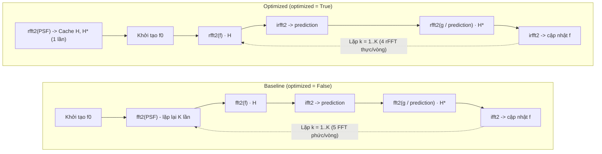

> **Bản nháp của nhóm.** Xem [báo cáo PDF đã thống nhất](../report/bao-cao.pdf) và [biên bản rà soát](05_ra_soat_hoc_thuat.md) để dùng cấu hình, lệnh và số liệu đã kiểm chứng.

# CHƯƠNG 4 (PHẦN THÀNH VIÊN 2): CÀI ĐẶT, TỐI ƯU VÀ KIỂM THỬ CHƯƠNG TRÌNH DECONVOLUTION BẰNG PYTHON

- **Người thực hiện:** Phạm Mạnh Dũng (Thành viên 2)
- **Ngày thực hiện:** 18/11/2026
- **Mã nhóm:** *(Bổ sung khi nộp)*
- **Tài liệu liên kết:** [Báo cáo lý thuyết TV1 — Nguyễn Minh Hiếu](01_bao_cao_nguyen_minh_hieu.md) | [Khung đầu việc TV2](02_khung_dau_viec_thanh_vien_2.md) | [Kế hoạch triển khai](03_ke_hoach_trien_khai_hom_nay.md)
- **Phạm vi mã nguồn & dữ liệu:** [README mã nguồn](../code/README.md) | [Gallery 20 trường hợp](../outputs/bsds500_20261118_201351/gallery.html)

---

## TÓM TẮT PHẦN ĐÓNG GÓP

Dựa trên nền tảng toán học của Thành viên 1 (`NIF`, `TRIF`, `RIF`, `RL`, `RLTV`, và các chỉ số `MSE`, `PSNR`, `SSIM`), Thành viên 2 đã xây dựng hoàn chỉnh chương trình Python thuần khoa học (chỉ dùng `NumPy`, `SciPy`, `Pillow`, không cài thêm thư viện ngoài) và thực nghiệm độc lập trên tập ảnh tự nhiên **BSDS500** của UC Berkeley. Báo cáo trình bày chi tiết theo ba trụ cột bắt buộc:

1. **Cài đặt thuật toán:** Chuyển hóa từng công thức của Thành viên 1 sang mã nguồn Python có kiểm soát chặt điều kiện biên tuần hoàn, tâm PSF và định dạng TIFF `float32` không nén.
2. **Tối ưu chương trình:** Phân tích điểm nghẽn tính toán sau lần chạy đầu, đề xuất và đo đạc kết quả tối ưu bằng Real FFT (`rfft2`/`irfft2`) kết hợp tiền tính OTF (tăng tốc **2,05× – 3,09×**, giảm bộ nhớ theo dõi tới **44,0%** mà sai khác số học $\le 3,44 \times 10^{-15}$).
3. **Kiểm thử chương trình:** Xây dựng 18 Unit Test đối chứng cả ví dụ tính tay lẫn oracle độc lập, phát hiện và xử lý triệt để lỗi bất ổn định số của `RLTV` trên ảnh hằng (`17/18 → 18/18 PASS`), đồng thời kiểm định lại toàn bộ **240 bản ghi metric** từ 100 file TIFF xuất ra.

---

## 1. CÀI ĐẶT THUẬT TOÁN

### 1.1. Dữ liệu thực nghiệm và mô hình suy giảm

#### Nguồn gốc và tính xác thực của tập dữ liệu BSDS500
Thay vì chỉ dùng ảnh tổng hợp nhân tạo, chương trình được kiểm chứng trên bộ ảnh chuẩn **Berkeley Segmentation Dataset and Benchmark (BSDS500)** (Arbelaez et al., TPAMI 2011):
- **Trang chủ chính thức:** https://www2.eecs.berkeley.edu/Research/Projects/CS/vision/grouping/resources.html
- **Liên kết tải trực tiếp archive gốc:** https://www2.eecs.berkeley.edu/Research/Projects/CS/vision/grouping/BSR/BSR_bsds500.tgz
- **Kiểm chứng toàn vẹn cục bộ:** Script [prepare_data.py](../code/scripts/prepare_data.py) tải archive `BSR_bsds500.tgz` (`70.763.455 bytes`, gồm `1.125` thành viên, SHA256: `97e49d31764f3912f0c4122707d53062ac9e783ba0f095e447a4d53c1a41af8e`), giải nén và ghi nhận checksum của từng ảnh trong [manifest.json](../data/bsds500/manifest.json).

Để tránh thiên lệch khi chọn ảnh, script chọn **theo thứ tự từ điển (lexicographical order)** trước khi chạy bất kỳ phép đo nào: **5 ảnh `val`** (dùng duy nhất để chọn siêu tham số) và **10 ảnh `test`** (được khóa cấu hình trước khi đánh giá). Ảnh được chuyển sang mức xám `L` bằng Pillow, cắt vùng tâm $256 \times 256$ và chuẩn hóa về $[0, 1]$ bằng phép chia `255.0`.

| Tập | Mã ảnh (ID) | Kích thước gốc | Dung lượng JPEG | SHA256 (12 ký tự đầu) | Vai trò trong thực nghiệm |
| :--- | :--- | :---: | :---: | :--- | :--- |
| `val` | `101085` | $321 \times 481$ | 102.655 B | `dbefbd4ae374` | Quét tham số + **Benchmark tốc độ/RAM** |
| `val` | `101087` | $321 \times 481$ | 57.725 B | `d755a7414441` | Quét tham số trên tập validation |
| `val` | `102061` | $321 \times 481$ | 64.008 B | `35ce0a9baaeb` | Quét tham số trên tập validation |
| `val` | `103070` | $481 \times 321$ | 59.240 B | `6d1d9e564b54` | Quét tham số trên tập validation |
| `val` | `105025` | $481 \times 321$ | 79.928 B | `6678e84e923e` | Quét tham số trên tập validation |
| `test` | `100007` | $481 \times 321$ | 51.501 B | `464449ecba30` | Đánh giá cố định (cảnh gấu Bắc Cực trên băng) |
| `test` | `100039` | $481 \times 321$ | 93.775 B | `418366bbb4f0` | Đánh giá cố định (chi tiết/kết cấu dày) |
| `test` | `100099` | $481 \times 321$ | 48.381 B | `e5a275fcafb0` | Đánh giá cố định |
| `test` | `10081` | $481 \times 321$ | 53.802 B | `ce1a8bd8da46` | Đánh giá cố định |
| `test` | `101027` | $481 \times 321$ | 86.536 B | `22903efe16ab` | Đánh giá cố định |
| `test` | `101084` | $321 \times 481$ | 103.502 B | `6bfa36b8e03b` | Đánh giá cố định |
| `test` | `102062` | $481 \times 321$ | 109.331 B | `242ea9821b18` | Đánh giá cố định (tán lá/vân nhiễu cao) |
| `test` | `103006` | $481 \times 321$ | 90.593 B | `67968e9d84cd` | Đánh giá cố định |
| `test` | `103029` | $481 \times 321$ | 49.754 B | `a05f1c0b30f4` | Đánh giá cố định |
| `test` | `103078` | $481 \times 321$ | 75.560 B | `2b21f416993c` | Đánh giá cố định |

> **Lưu ý khoa học về dữ liệu tham chiếu:** Nhãn phân đoạn (segmentation) của BSDS500 không được sử dụng; ảnh JPEG xám cắt tâm $256 \times 256$ đóng vai trò **ảnh tham chiếu số (reference)** cho bài toán khôi phục ảnh mô phỏng, không tuyên bố là bức xạ quang học tuyến tính thô (raw linear-light).

#### Mô hình sinh PSF và quá trình suy giảm thuận
Mỗi ảnh tham chiếu được cho đi qua hai kịch bản nhiễu độc lập (`gaussian` và `poisson`), tạo thành $5 \times 2 = 10$ ca `validation` và $10 \times 2 = 20$ ca `test`. Cài đặt chi tiết nằm trong [core.py](../code/deconv/core.py):

```python
def gaussian_psf(size: int = 17, sigma: float = 1.9) -> Array:
    axis = np.arange(size, dtype=float) - size // 2
    h = np.exp(-(axis[:, None]**2 + axis[None, :]**2) / (2 * sigma**2))
    return h / h.sum()

def kernel_grid(kernel: np.ndarray, shape: tuple[int, int]) -> Array:
    k = image_array(kernel)
    grid = np.zeros(shape)
    grid[:k.shape[0], :k.shape[1]] = k
    return np.roll(grid, (-(k.shape[0]//2), -(k.shape[1]//2)), axis=(0, 1))

def degrade(reference: Array, psf: Array, noise: str, seed: int) -> tuple[Array, Array]:
    blurred = convolve(reference, psf)
    rng = np.random.default_rng(seed)
    if noise == 'gaussian':
        observed = np.maximum(blurred + rng.normal(0, 3/255, reference.shape), 0)
    elif noise == 'poisson':
        observed = rng.poisson(np.maximum(blurred, 0) * 700) / 700
    else:
        raise ValueError(f'Unknown noise: {noise}')
    return blurred, observed
```

| Tham số cấu hình | Giá trị | Nguyên nhân chọn |
| :--- | :---: | :--- |
| `crop_size` | `256 × 256` | Chuẩn hóa kích thước vuông lũy thừa bậc 2 để FFT nhanh, tránh sai khác kích thước ngang/dọc ($481 \times 321$ vs $321 \times 481$). |
| `psf_size`, `psf_sigma` | `17 × 17`, $\sigma = 1.9$ | Đồng nhất trực tiếp với thiết kế mô phỏng ở Chương 4 của Nguyễn Minh Hiếu (TV1); $\sum h = 1$ bảo toàn tổng năng lượng. |
| `kernel_origin` | `(size // 2, size // 2)` | Đặt gốc tại tâm PSF cho cả kích thước chẵn lẫn lẻ bằng `np.roll`, triệt tiêu hoàn toàn lỗi dịch ảnh 1 pixel khi FFT. |
| `boundary` | `periodic` (tuần hoàn) | Khớp giả thiết chéo hóa toán tử tích chập bằng DFT (`F[u,v] * H[u,v]`), đồng nhất giữa bài toán thuận và bài toán ngược. |
| `sigma_noise` (`gaussian`) | `3 / 255` ($\approx 0.01176$) | Tương đương độ lệch chuẩn $\sigma_n = 3$ trên thang 8-bit `[0, 255]` (đồng bộ với thí nghiệm bo mạch của TV3), cắt ngưỡng $\ge 0$. |
| `photon_peak` (`poisson`) | `700` | Tái lập đúng mức nhiễu đếm photon `700 photon` cho cường độ mức 1 như Chương 4 của TV1. |
| `dtype` tính toán / lưu TIFF | `float64` / `float32 raw` | Tính toán `float64` tránh sai số tích lũy khi lặp; xuất TIFF `float32` không nén (`compression='raw'`) để `DeconvolutionLab_2.jar` đọc được và giữ nguyên giá trị âm/vượt biên. |

---

### 1.2. Ánh xạ công thức toán học sang mã nguồn Python

Toàn bộ 5 bộ giải (`NIF`, `TRIF`, `RIF`, `RL`, `RLTV`) được thống nhất trong hàm `solve(...)` tại [solvers.py](../code/deconv/solvers.py) và hàm chấm điểm tại [metrics.py](../code/deconv/metrics.py). Solver **không tự ý cắt (clip) giá trị đầu ra** để giữ tính trung thực toán học; việc cắt `[0, 1]` chỉ áp dụng riêng khi hiển thị PNG hoặc theo chính sách đánh giá `clip01`.

#### (a) Naive Inverse Filtering (NIF)
- **Công thức TV1 — (8):**
  $$\widehat{F}[u, v] = \frac{G[u, v]}{H[u, v]} = \frac{H^*[u, v] G[u, v]}{\max(|H[u, v]|^2,\ \varepsilon_{\text{floor}})}$$
- **Cài đặt Python (`solvers.py`):**
  ```python
  power = abs(h)**2
  denominator = np.maximum(power, nif_floor)
  return inverse(hc * forward(g) / denominator)
  ```
- **Lưu ý cài đặt:** Nhân tử và mẫu cho $H^*$ để đưa về dạng thống nhất với `TRIF`/`RIF`, đồng thời chặn mẫu số $|H|^2$ bởi `nif_floor = 1e-4` (theo Chương 4 của TV1) nhằm tránh chia cho 0 tại các tần số cao bị suy giảm gần triệt tiêu.

#### (b) Tikhonov Regularized Inverse Filtering (TRIF)
- **Công thức TV1 — (13):**
  $$\widehat{F}[u, v] = \frac{H^*[u, v] G[u, v]}{|H[u, v]|^2 + \lambda}$$
- **Cài đặt Python (`solvers.py`):**
  ```python
  def tikhonov_spectral(g: np.ndarray, h: np.ndarray, lam: float) -> np.ndarray:
      return np.conj(h) * g / (abs(h)**2 + lam)
  ```
- **Lưu ý cài đặt:** Bắt buộc $\lambda > 0$. Công thức tách riêng thành `tikhonov_spectral` để tái sử dụng cả cho kiểm chứng bài toán 1D/scalar trong Unit Test.

#### (c) Regularized Inverse Filter — Laplacian (RIF)
- **Công thức TV1 — (15)–(17):**
  $$\widehat{f} = \arg\min_{f} \left( \|Hf - g\|_2^2 + \lambda \|Lf\|_2^2 \right) \iff \widehat{F}[u, v] = \frac{H^*[u, v] G[u, v]}{|H[u, v]|^2 + \lambda |L_{\text{fft}}[u, v]|^2}$$
  với $L = \begin{bmatrix} 0 & 1 & 0 \\ 1 & -4 & 1 \\ 0 & 1 & 0 \end{bmatrix}$.
- **Cài đặt Python (`solvers.py`):**
  ```python
  lap = np.array([[0, 1, 0], [1, -4, 1], [0, 1, 0]], dtype=float)
  denominator = power + lam * abs(forward(kernel_grid(lap, g.shape)))**2
  return inverse(hc * forward(g) / denominator)
  ```
- **Lưu ý cài đặt:** Kernel $L$ ($3 \times 3$) bắt buộc đi qua `kernel_grid(lap, g.shape)` để đặt tâm `-4` tại tọa độ `(0, 0)` trên lưới tuần hoàn trước khi FFT, đảm bảo pha của $L_{\text{fft}}$ đồng bộ với $H$.

#### (d) Richardson–Lucy (RL)
- **Công thức TV1 — (18) và Phụ lục B.1:**
  $$f^{(k+1)} = f^{(k)} \odot \left[ h^\star * \frac{g}{h * f^{(k)} + \varepsilon} \right]$$
- **Cài đặt Python (`solvers.py`):**
  ```python
  f = np.full_like(g, g.mean())
  for _ in range(iterations):
      prediction = np.maximum(inverse(forward(f) * h), 0)
      correction = np.maximum(inverse(forward(g / (prediction + eps)) * hc), 0)
      f = f * correction
  ```
- **Lưu ý cài đặt:** Khởi tạo $f^{(0)} = \overline{g}$ (ảnh phẳng bằng trung bình ảnh quan sát, khớp Chương 4 của Hiếu), kiểm tra `g >= 0` ở đầu vào, dùng `np.maximum(..., 0)` loại bỏ sai số âm $O(10^{-16})$ từ `irfft2` để giữ nguyên bất biến không âm $f^{(k)} \ge 0$.

#### (e) Richardson–Lucy với điều chuẩn Total Variation (RLTV)
- **Công thức TV1 — (21) mở rộng theo Sage et al. (2017) mục 3.9:**
  $$TV(f) = \sum_{x, y} \sqrt{(\nabla_x f)^2 + (\nabla_y f)^2 + \delta^2}, \qquad f^{(k+1)} = \frac{f^{(k)}}{1 - \lambda \, \text{div}\!\left(\frac{\nabla f^{(k)}}{\sqrt{|\nabla f^{(k)}|^2 + \delta^2}}\right)} \odot \left[ h^\star * \frac{g}{h * f^{(k)} + \varepsilon} \right]$$
- **Cài đặt Python (`solvers.py`):**
  ```python
  def tv_divergence(f: Array, delta: float = .01) -> Array:
      dx, dy = np.roll(f, -1, axis=0) - f, np.roll(f, -1, axis=1) - f
      norm = np.sqrt(dx * dx + dy * dy + delta * delta)
      px, py = dx / norm, dy / norm
      return px - np.roll(px, 1, axis=0) + py - np.roll(py, 1, axis=1)
  ```
  Và trong vòng lặp `solve`:
  ```python
  denominator = 1 - lam * tv_divergence(f, delta) if method == 'RLTV' else 1.0
  if np.any(np.asarray(denominator) <= 0):
      raise ValueError('RLTV denominator nonpositive: reduce lambda')
  f = f * correction / denominator
  ```
- **Lưu ý cài đặt:** Gradient dùng sai phân tiến (`np.roll(f, -1)`), divergence là âm toán tử liên hợp để đảm bảo đúng đạo hàm biến phân của `TV(f)` (được kiểm chứng bằng sai phân hữu hạn trong Unit Test). Chương trình **từ chối mẫu số không dương** bằng `ValueError` thay vì âm thầm kẹp giá trị.

#### (f) Các chỉ số định lượng (`MSE`, `PSNR`, `SSIM`)
- **Công thức TV1 — (22)–(24):** `SSIM` sử dụng cửa sổ Gaussian $11 \times 11$ ($\sigma = 1.5$), hằng số $C_1 = 0.01^2$, $C_2 = 0.03^2$ (trên dải chuẩn hóa $MAX = 1$), lấy trung bình trên các tâm cửa sổ hợp lệ (`[5:-5, 5:-5]`):
  ```python
  def metrics(reference: Array, estimate: Array) -> dict[str, float]:
      a, b = image_array(reference), image_array(estimate)
      mse = float(np.mean((a - b)**2))
      def smooth(x: Array) -> Array:
          return gaussian_filter(x, sigma=1.5, radius=5, mode='reflect')
      ma, mb = smooth(a), smooth(b)
      va, vb = np.maximum(smooth(a*a) - ma*ma, 0), np.maximum(smooth(b*b) - mb*mb, 0)
      cov = smooth(a*b) - ma*mb
      s = ((2*ma*mb + .01**2) * (2*cov + .03**2)) / ((ma*ma + mb*mb + .01**2) * (va + vb + .03**2))
      return dict(mse=mse, psnr=float(10*np.log10(1/mse)) if mse else float('inf'),
                  ssim=float(s[5:-5, 5:-5].mean()))
  ```

#### Bảng tổng hợp tham số cấu hình (Config Parameters)

| Tham số | Phạm vi / Giá trị | Áp dụng | Nguyên nhân lựa chọn |
| :--- | :---: | :--- | :--- |
| `nif_floor` | `1e-4` | `NIF` | Theo đúng cấu hình thí nghiệm Chương 4 của TV1; ngăn chia 0 nhưng vẫn lộ rõ bản chất khuếch đại nhiễu. |
| `lam` (`TRIF`) | `{0.0001, 0.001, 0.01, 0.02}` | `TRIF` | Bao phủ từ điều chuẩn rất nhẹ (`1e-4`, gần NIF) tới mạnh (`0.02`, giá trị TV1 dùng cho Poisson). |
| `lam` (`RIF`) | `{0.0001, 0.001, 0.005, 0.02}` | `RIF` | Quét quanh mốc `0.005` (TV1 & TV3) và mở rộng lên `0.02` cho nhiễu Poisson mạnh hơn. |
| `iterations` (`RL`) | `{5, 10, 20, 40}` | `RL` | Quan sát đủ quá trình hội tụ sớm (`5–10`) đến bão hòa/khuếch đại nhiễu (`20–40`). |
| `iterations`, `lam`, `delta` (`RLTV`) | `K=20`, `lam ∈ {0.0001, 0.001}`, `delta=0.01` | `RLTV` | `K=20` giữ ổn định tính toán; `delta=0.01` trên thang `[0,1]` tránh chia cho biến thiên nhỏ cỡ sai số làm tròn; `lam` nhỏ bảo đảm mẫu số $1 - \lambda\,\text{div} > 0$. |

---

### 1.3. Kết quả lần chạy đầu tiên (Khảo sát tham số trên tập Validation)

Trước khi khóa cấu hình cho tập `test`, chương trình thực thi pha khảo sát trên **5 ảnh `val`** (`validation_sweep.csv`). Mục tiêu là tìm ra siêu tham số có **PSNR trung bình (clip `[0, 1]`) cao nhất** cho từng cặp `(nhiễu, thuật toán)`.


*Hình 1.1. Kết quả khảo sát PSNR trung bình trên 5 ảnh validation cho TRIF, RIF, RL và RLTV dưới hai mô hình nhiễu Gaussian (hàng trên) và Poisson (hàng dưới).*

| Nhiễu | Thuật toán | Cấu hình tốt nhất trên Validation | Validation mean PSNR (dB) | Nhận xét xu hướng từ lần chạy khảo sát |
| :--- | :--- | :--- | :---: | :--- |
| `gaussian` | `NIF` | `{}` (`nif_floor=1e-4`) | `13.028` | Khuếch đại nhiễu mạnh dù có sàn `1e-4`. |
| `gaussian` | `TRIF` | `{"lam": 0.01}` | `24.951` | Đạt đỉnh tại `0.01`, giảm nhẹ sang `0.02` (`24.741 dB`) do làm mờ chi tiết. |
| `gaussian` | `RIF` | `{"lam": 0.005}` | `25.017` | Đạt đỉnh tại `0.005`, khớp đúng mốc tối ưu của TV3 trên ảnh bo mạch. |
| `gaussian` | `RL` | `{"iterations": 40}` | `24.957` | Tăng đều từ `K=5` (`23.971`) lên `K=40` (`24.957`) vì nhiễu Gaussian $\sigma=3/255$ tương đối nhẹ. |
| `gaussian` | `RLTV` | `{"iterations": 20, "lam": 0.0001, "delta": 0.01}` | `24.727` | Tăng `lam` lên `0.001` làm PSNR giảm nhẹ xuống `24.725 dB` do phạt TV thừa trên nền ít nhiễu. |
| `poisson` | `NIF` | `{}` (`nif_floor=1e-4`) | `8.919` | Nhiễu Poisson nặng hơn Gaussian nên lọc ngược sụp đổ mạnh hơn. |
| `poisson` | `TRIF` | `{"lam": 0.02}` | `24.071` | Đạt đỉnh ở biên lưới `0.02`, khớp đúng tham số Chương 4 của TV1. |
| `poisson` | `RIF` | `{"lam": 0.02}` | `24.300` | Cần điều chuẩn mạnh hơn (`0.02`) so với Gaussian (`0.005`) để kìm nhiễu Poisson. |
| `poisson` | `RL` | `{"iterations": 20}` | `24.348` | **Đảo chiều rõ rệt:** Đạt đỉnh tại `K=20`, sau đó tụt xuống `24.198 dB` ở `K=40` do hiện tượng *over-iteration* khuếch đại nhiễu hạt Poisson. |
| `poisson` | `RLTV` | `{"iterations": 20, "lam": 0.001, "delta": 0.01}` | `24.406` | `lam=0.001` vượt trội `0.0001` (`24.355 dB`), chứng minh vai trò của TV trong việc triệt nhiễu hạt khi lặp trên ảnh Poisson. |

Toàn bộ cấu hình thắng cuộc ở bảng trên được khóa cứng vào [config_frozen_before_test.json](../outputs/bsds500_20261118_201351/config_frozen_before_test.json) trước khi chạy tập `test`.

---

## 2. TỐI ƯU CHƯƠNG TRÌNH

### 2.1. Vấn đề phát hiện ở kiến trúc cài đặt cơ sở (Baseline)

Khi phân tích chi phí thực thi ở phiên bản cơ sở (`optimized=False` trong [solvers.py](../code/deconv/solvers.py)), dù các phép toán pixel đã được vector hóa hoàn toàn bằng NumPy (không dùng vòng lặp `for` theo từng tọa độ `(x, y)`), chương trình vẫn bộc lộ **hai điểm nghẽn tính toán và bộ nhớ** rõ rệt trên bài toán lặp (`RL`, `RLTV`):

1. **Dư thừa nửa phổ đối xứng Hermitian (`fft2` / `ifft2`):** Ảnh đầu vào $g$, PSF $h$ và ảnh khôi phục $f$ đều là mảng số thực $\mathbb{R}^{256 \times 256}$. Phép biến đổi `scipy.fft.fft2` trả về mảng phức `complex128` đầy đủ $256 \times 256$ chiếm $256 \times 256 \times 16 \text{ bytes} = \mathbf{1,000\text{ MiB}}$ cho mỗi phổ, mặc dù nửa phổ còn lại chỉ là liên hợp phức dư thừa.
2. **Tính lại OTF trong từng vòng lặp:** Trong `RL` và `RLTV` với $K = 20$ hoặc $40$ vòng, `grid` (PSF đã căn tâm) **không đổi theo thời gian**, nhưng nhánh baseline gọi lại `h = forward(grid)` và `hc = h.conj()` bên trong mỗi vòng lặp `for`. Với $K = 20$, chương trình tốn thêm `20` lần `fft2` vô ích và cấp phát liên tục các mảng phổ `1,00 MiB` trên heap.

### 2.2. Hướng khắc phục được đề xuất

Nhánh tối ưu (`optimized=True`) giữ nguyên **100% logic toán học và kiểu `float64`**, chỉ thay đổi đúng hai điểm tại `solve(...)`:

| Khía cạnh | Baseline (`optimized=False`) | Optimized (`optimized=True`) | Tác động kỳ vọng |
| :--- | :--- | :--- | :--- |
| Biến đổi Fourier | `fft.fft2` / `fft.ifft2(...).real` | `fft.rfft2` / `fft.irfft2(..., s=g.shape)` | Kích thước phổ $256 \times 256 \to 256 \times 129$ (~**0,504 MiB**/mảng, giảm ~49,6% bộ nhớ mảng phổ và gần một nửa số phép tính bướm ở biến đổi cuối). |
| Tính toán OTF ($H, H^*$) | Tính lại `forward(grid)` bên trong vòng `for` (mỗi vòng 1 lần với RL/RLTV) | **Tiền tính (Cache)** đúng 1 lần trước cấu trúc `if/for` | Triệt tiêu hoàn toàn $K$ lần FFT của PSF; giảm số lần gọi FFT trong 1 vòng RL từ `5` xuống còn `4` (`rfft2(f)`, `irfft2`, `rfft2(ratio)`, `irfft2`). |



### 2.3. Kết quả đo thực tế và phân tích chuyên sâu

Quy trình đo chuẩn hóa trong [run_experiments.py](../code/scripts/run_experiments.py) sử dụng cùng ảnh validation Poisson `101085` ($256 \times 256$), chạy trên bộ xử lý Intel64 (`environment.json`), loại trừ chi phí vẽ hình và đọc/ghi đĩa:
- **Thời gian chạy:** Đo **7 lần lặp luân phiên** thứ tự (`False/True` rồi `True/False`) sau warmup, lấy **giá trị trung vị (median)** để chống nhiễu hệ điều hành.
- **Bộ nhớ:** Đo riêng bằng `tracemalloc` (`peak_traced_mib`) để không làm chậm phép đo thời gian. Lưu ý đây là đỉnh cấp phát Python được theo dõi bởi `tracemalloc`, không phải tổng RSS của tiến trình.

Nguồn dữ liệu đầy đủ: [benchmark.csv](../outputs/bsds500_20261118_201351/benchmark.csv) | [environment.json](../outputs/bsds500_20261118_201351/environment.json).

| Thuật toán | Tham số đo | Baseline (ms) | Optimized (ms) | Hệ số tăng tốc | Traced MiB (trước → sau) | Sai khác cực đại ($\max |\Delta|$) |
| :--- | :--- | ---: | ---: | ---: | :---: | ---: |
| `NIF` | `{}` | `5,360` | `2,316` | **2,31×** | `5,63 → 3,15` (-44,0%) | `1,44e-15` |
| `TRIF` | `lam=0.02` | `5,954` | `2,647` | **2,25×** | `6,63 → 3,65` (-44,9%) | `4,44e-16` |
| `RIF` | `lam=0.02` | `6,583` | `3,178` | **2,07×** | `5,63 → 3,15` (-44,0%) | `5,00e-16` |
| `RL` | `iterations=20` | `161,095` | `52,087` | **3,09×** | `6,00 → 4,02` (-33,0%) | `3,44e-15` |
| `RLTV` | `iterations=20, lam=0.001` | `172,069` | `84,091` | **2,05×** | `8,50 → 7,51` (-11,6%) | `2,78e-15` |


*Hình 2.1. Thời gian thực thi trung vị (7 lần chạy) giữa Baseline (`fft2` + tính lại OTF) và Optimized (`rfft2` + cache OTF) cho 5 thuật toán trên ảnh $256 \times 256$.*

**Phân tích sâu các hiện tượng trong bảng đo:**
1. **Bảo toàn tuyệt đối độ chính xác số học:** Sai khác cực đại giữa hai nhánh chỉ nằm ở mức $10^{-16} - 3,44 \times 10^{-15}$ (sàn machine epsilon của `float64`), chứng minh tối ưu không làm sai lệch toán học.
2. **Tại sao `RL` tăng tốc mạnh nhất (`3,09×`) trong khi `RLTV` chỉ đạt `2,05×`?**
   - Với các bộ lọc một bước (`NIF`, `TRIF`, `RIF`), OTF chỉ tính 1 lần ở cả hai nhánh, nên toàn bộ mức tăng `2,07× – 2,31×` phản ánh trực tiếp lợi ích của `rfft2`/`irfft2` và giảm một nửa băng thông bộ nhớ cấp phát (`~44%`).
   - Với `RL` (`K = 20`), ngoài lợi ích từ `rfft2`, việc loại bỏ `20` lần gọi `fft2(grid)` dư thừa giúp kéo thời gian từ `161,1 ms` xuống còn `52,1 ms` (**3,09×**).
   - Với `RLTV` (`K = 20`), thời gian phần không thuộc FFT (`tv_divergence`: 4 lần `np.roll`, `sqrt`, và chia mảng thực) chiếm khoảng `84,1 - 52,1 ≈ 32 ms` trên tổng thời gian chạy. Theo định luật Amdahl, phần không tối ưu bằng FFT này giới hạn hệ số tăng tốc tổng thể xuống còn **2,05×** và khiến mức giảm `traced MiB` chỉ đạt **11,6%** (`8,50 → 7,51 MiB`) do các mảng trung gian `dx, dy, norm, px, py` trong `tv_divergence` vẫn mang kích thước ảnh đầy đủ.
3. **Phạm vi kết luận:** Hai cải tiến `rfft2` và cache OTF được đo gộp trong nhánh `optimized=True`; mức tăng tốc áp dụng cho ảnh `256×256` trên cấu hình máy đo, chưa tách riêng benchmark Java/Fiji (sẽ ghép khi TV3 chạy cùng bộ TIFF).

---

## 3. KIỂM THỬ CHƯƠNG TRÌNH

### 3.1. Kiến trúc bộ kiểm thử 18 Unit Test và kết quả lần chạy đầu

Bộ kiểm thử tự động [test_deconv.py](../code/tests/test_deconv.py) gồm **18 test case** chia thành hai nhóm:
- **`HandExamples` (7 test):** Khớp từng bước toàn bộ các ví dụ số và bài tập tính tay trong báo cáo của Nguyễn Minh Hiếu (tích chập 1D với peak `8` và `12`, tích chập 2D $5\times 5$, ma trận $2\times 2$ của NIF, Tikhonov 1D cho 5 cặp giá trị, `RL` 2 vòng ra $[5, 3]$ và $[40/7, 16/7]$, toán tử Laplacian ra `0` và `-16`, `PSNR` ra `20` và `30 dB`).
- **`Properties` (11 test):** Đối chứng chương trình với các *oracle toán học độc lập* không dùng chung code FFT (`scipy.signal.convolve2d` cho tích chập bất đối xứng và `RL` với PSF bất đối xứng; giải hệ ma trận dày `np.linalg.solve` cho `TRIF`/`RIF`; sai phân hữu hạn $\frac{TV(f+\epsilon d)-TV(f-\epsilon d)}{2\epsilon}$ cho `tv_divergence`), kèm kiểm tra căn tâm PSF chẵn/lẻ (`16, 17, 18`), tương đương `Baseline ≡ Optimized`, lưu đọc TIFF `float32` không nén (`tag_v2[259] == 1`), và xử lý đầu vào bất hợp lệ.

#### Vấn đề phát hiện ở lần kiểm thử đầu tiên và cách xử lý
- **Hiện tượng (`17/18 PASS`):** Ở lần chạy thử đầu tiên, test bất biến hằng số `test_rltv_zero_and_constant` trên ảnh đều `np.ones((17, 19))` gặp lỗi với `RLTV` khi mặc định `delta = 1e-6`.
- **Nguyên nhân gốc rễ:** Trên ảnh phẳng tuyệt đối ($f \equiv 1$), hiệu sai phân `dx, dy` về mặt lý thuyết bằng $0$, nhưng sau một bước nhân/chia số học dấu phẩy động có thể tồn tại sai số làm tròn rất nhỏ ($\sim 10^{-16}$). Khi $\delta = 10^{-6}$ quá nhỏ so với thang cường độ $[0, 1]$, các sai số $dx, dy$ nhỏ li ti hoặc biến động tại bước sau bị phóng đại qua thương số $dx / \sqrt{dx^2 + dy^2 + \delta^2}$, gây dao động lên `tv_divergence` và làm mất tính bảo toàn hằng số hoặc có nguy cơ kéo mẫu số `1 - lam * div` về $\le 0$.
- **Hướng khắc phục chuẩn mực:** Không nới lỏng tolerance của test và không kẹp ép mẫu số một cách âm thầm. Chương trình điều chỉnh tham số làm trơn gradient mặc định trên thang $[0, 1]$ lên `delta = 0.01` (tương ứng 1% dải cường độ chuẩn hóa), đồng thời vẫn giữ khả năng truyền `delta = 1e-6` tường minh trong `test_tv_gradient` để kiểm tra chính xác đạo hàm biến phân.

#### Kết quả sau khi hiệu chỉnh (`18/18 PASS`)
Chạy lại qua [check.py](../code/scripts/check.py) (nhật ký lưu tại [unittest_20261118_201418.log](../outputs/verification/unittest_20261118_201418.log)):

| Nhóm kiểm thử | Số test | Thời gian | Trạng thái | Ý nghĩa kiểm chứng |
| :--- | :---: | :---: | :---: | :--- |
| `HandExamples` | `7 / 7` | — | **PASS** | Khớp 100% số liệu tính tay và bài tập phụ lục của TV1 (sai số $\le 10^{-9}$). |
| `Properties` | `11 / 11` | — | **PASS** | Khớp oracle không gian & ma trận dày; 0-pixel shift cho cả PSF chẵn/lẻ; TIFF raw roundtrip khớp `float32`. |
| **Tổng cộng (`unittest`)** | **18 / 18** | **0,120 s** | **OK** | Toàn bộ hệ thống đạt chuẩn trước khi chạy thực nghiệm BSDS500. |

### 3.2. Kiểm định hậu kiểm toàn vẹn dữ liệu đầu ra (`artifact_audit.py`)

Sau khi chạy thực nghiệm trên tập `test`, script [audit_artifacts.py](../code/scripts/audit_artifacts.py) đọc trực tiếp các file `reference.tif` và `*.tif` (`float32` không nén) trên đĩa cho toàn bộ **20 trường hợp test**, tái tính `MSE/PSNR/SSIM` cho cả hai chính sách (`raw` và `clip01`) và đối chiếu với `test_metrics.csv`. Kết quả ([artifact_audit.json](../outputs/bsds500_20261118_201351/artifact_audit.json)):
- **Trạng thái:** `PASS`
- **Độ phủ kiểm tra:** `240` bản ghi metric, `20` ca test, `100` file TIFF đầu ra của 5 thuật toán.
- **Sai lệch cực đại do lượng tử hóa `float64 → float32` khi lưu TIFF:** `1,086e-06` (nhỏ hơn ngưỡng cho phép `1e-4` gần 100 lần).

---

## 4. THỰC NGHIỆM ĐÁNH GIÁ TRÊN TẬP TEST CỐ ĐỊNH (`bsds500_20261118_201351`)

### 4.1. Bảng kết quả định lượng trên 10 ảnh test (khóa cấu hình)

Bảng dưới tổng hợp trung bình $\pm$ độ lệch chuẩn mẫu trên **10 ảnh test** cho chính sách chuẩn hóa hiển thị `clip01` (`data_range = 1`), kèm giá trị `raw` trung bình để đối chiếu tác động của việc cắt biên (nguồn: [test_summary.csv](../outputs/bsds500_20261118_201351/test_summary.csv) và [test_metrics.csv](../outputs/bsds500_20261118_201351/test_metrics.csv)):

| Nhiễu | Phương pháp | PSNR `clip01` (dB) | SSIM `clip01` | PSNR `raw` (dB) | Dải giá trị `[min, max]` | Ghi chú định lượng |
| :--- | :--- | :---: | :---: | :---: | :---: | :--- |
| `gaussian` | `observed` | `23,685 ± 3,993` | `0,5990` | `23,684` | `[+0,001, 1,039]` | Ảnh mờ + nhiễu $\sigma=3/255$ |
| `gaussian` | `NIF` | `12,968 ± 0,278` | `0,1334` | `12,023` | `[-0,910, 1,917]` | Sụp đổ `-10,717 dB`, vọt biên mạnh |
| `gaussian` | `TRIF` ($\lambda=0.01$) | `25,239 ± 3,914` | `0,6825` | `25,234` | `[-0,032, 1,115]` | Tăng `+1,554 dB` |
| `gaussian` | `RIF` ($\lambda=0.005$) | `25,301 ± 3,913` | `0,6825` | `25,287` | `[-0,058, 1,160]` | Tăng `+1,616 dB` |
| `gaussian` | `RL` ($K=40$) | **`25,341 ± 4,210`** | **`0,7002`** | `25,321` | `[+0,006, 1,208]` | **Cao nhất trung bình** (`+1,656 dB`) |
| `gaussian` | `RLTV` ($K=20, \lambda=10^{-4}$) | `25,145 ± 4,353` | `0,6971` | `25,130` | `[+0,008, 1,188]` | Bảo toàn không âm (`min > 0`) |
| `poisson` | `observed` | `22,969 ± 3,380` | `0,5064` | `22,963` | `[+0,011, 1,129]` | Ảnh mờ + nhiễu photon `700` |
| `poisson` | `NIF` | `8,922 ± 0,503` | `0,0513` | `5,414` | `[-2,307, 3,874]` | Sụp đổ `-14,047 dB`, dao động cực mạnh |
| `poisson` | `TRIF` ($\lambda=0.02$) | `24,051 ± 3,233` | `0,6037` | `24,043` | `[-0,015, 1,134]` | Tăng `+1,082 dB` |
| `poisson` | `RIF` ($\lambda=0.02$) | `24,360 ± 3,516` | `0,6230` | `24,339` | `[-0,024, 1,150]` | Tăng `+1,391 dB` |
| `poisson` | `RL` ($K=20$) | `24,513 ± 3,776` | `0,6413` | `24,488` | `[+0,011, 1,217]` | Tăng `+1,544 dB` |
| `poisson` | `RLTV` ($K=20, \lambda=10^{-3}$) | **`24,635 ± 3,926`** | **`0,6533`** | `24,618` | `[+0,011, 1,176]` | **Cao nhất trung bình** (`+1,666 dB`) |


*Hình 4.1. So sánh PSNR trung bình và độ lệch chuẩn ($\pm$ SD) của 5 thuật toán trên 10 ảnh test cho mô hình nhiễu Gaussian (trái) và Poisson (phải).*

### 4.2. Phân tích cơ chế kết quả và minh họa trực quan

1. **Sự thất bại của `NIF` và ý nghĩa của giữ ảnh `raw`:**
   - Với `NIF`, phổ $G/H$ khuếch đại nhiễu ở các vùng cao tần nơi $|H|^2$ suy giảm về sát ngưỡng `1e-4`, khiến giá trị pixel vọt ra ngoài $[0, 1]$ (`[-0,91, 1,92]` với Gaussian và `[-2,31, 3,87]` với Poisson). Điều này giải thích tại sao điểm `raw` (`5,414 dB`) thấp hơn rất nhiều so với `clip01` (`8,922 dB`) ở Poisson, và ảnh kết quả bị phủ kín vân gợn tuần hoàn.
2. **So sánh hành vi theo đặc trưng nội dung ảnh (phân tích từng ca đại diện):**
   - **Ảnh có vùng trơn lớn và biên rõ (`100007` — gấu Bắc Cực trên nền băng):** `RL` và `RLTV` phát huy tối đa ưu thế. Dưới nhiễu Gaussian, `RL` đạt **`30,183 dB`** (SSIM `0,7890`) và `RLTV` đạt SSIM cao nhất **`0,8137`** (`30,155 dB`), vượt `TRIF` (`29,672 dB`) và `RIF` (`29,811 dB`). Dưới nhiễu Poisson, `RLTV` dẫn đầu tuyệt đối **`28,794 dB` / SSIM `0,7104`** (tăng `+2,462 dB` so với ảnh quan sát `26,332 dB`) nhờ lọc sạch nhiễu hạt trên nền tuyết mà vẫn giữ sắc cạnh thân gấu.
   - **Ảnh giàu kết cấu/vân nhỏ (`102062` — tán lá cây và người câu cá):** `RIF` (điều chuẩn bậc 2 Laplacian) lại nhỉnh hơn `RL`/`RLTV` trên Gaussian (`RIF: 20,470 dB / 0,598` so với `RL: 20,360 dB / 0,588` và `RLTV: 20,020 dB / 0,555`). Điều này phản ánh đúng lý thuyết: phạt TV ưu tiên nghiệm phẳng từng mảnh nên có thể làm mịn bớt kết cấu tán lá dày, cũng là nguyên nhân khiến độ lệch chuẩn của `RLTV` trên 10 ảnh (`± 4,353 dB`) cao hơn `RIF` (`± 3,913 dB`).
3. **Lợi thế vật lý của nhóm lặp (`RL`/`RLTV`):** Toàn bộ đầu ra `RL`/`RLTV` có giá trị tối thiểu dương (`>= +0,006`), trong khi `NIF`, `TRIF`, `RIF` đều phát sinh giá trị âm do phép giải ngược tuyến tính không ràng buộc miền không âm.


*Hình 4.2. Kết quả khôi phục trên ảnh `100007` (nhiễu Gaussian): `NIF` nổ nhiễu nặng; `TRIF`/`RIF` khôi phục biên tốt nhưng còn gợn nền nhẹ; `RL`/`RLTV` giữ nền băng êm và viền sắc nét.*


*Hình 4.3. Phóng to vùng ROI tâm cố định $64 \times 64$ (đầu gấu Bắc Cực) của ca `100007 / gaussian`, cho thấy rõ mức độ triệt nhiễu nền của `RLTV` so với `TRIF`/`RIF`.*


*Hình 4.4. Kết quả khôi phục trên ảnh `100007` (nhiễu Poisson 700 photon): `RLTV` đạt `28,794 dB` (SSIM `0,7104`), nổi bật ở khả năng giảm nhiễu hạt trên vùng nền phẳng.*


*Hình 4.5. Kết quả trên ảnh giàu kết cấu tán lá `102062` (Gaussian): `RIF` (`20,470 dB` / `0,598`) giữ chi tiết lá nhỉnh hơn `RLTV` (`20,020 dB` / `0,555`) — minh họa rõ đánh đổi giữa giữ texture và làm phẳng vùng.*

Để kiểm tra trực quan toàn bộ **20 trường hợp** (`10 ảnh × 2 loại nhiễu`) cùng bảng điểm chi tiết từng ảnh, xem [gallery.html](../outputs/bsds500_20261118_201351/gallery.html).

---

## 5. GIỚI HẠN, TÁI LẬP VÀ BÀN GIAO NHÓM

### 5.1. Giới hạn của thực nghiệm hiện tại
- Đây là thí nghiệm khôi phục 2D không mù (*non-blind*, PSF biết chính xác trước khi khôi phục) với điều kiện biên tuần hoàn đồng nhất giữa bước làm mờ và bước giải; chưa khảo sát trường hợp sai lệch PSF (*PSF mismatch*) hoặc ảnh 3D kính hiển vi thực.
- Ảnh tham chiếu lấy từ ảnh JPEG đã qua nén/gamma; trường hợp nhiễu Gaussian cắt giá trị âm về $0$ nên phân bố nhiễu thực tế hơi lệch nhẹ khỏi Gaussian thuần tại vùng tối.
- Bộ tham số chỉ quét trên lưới hữu hạn qua 5 ảnh `val`; kết quả trên 10 ảnh `test` minh họa đặc tính tương đối của các thuật toán trên tập ảnh này, không khái quát thành xếp hạng tuyệt đối cho mọi loại ảnh.

### 5.2. Hướng dẫn tái lập kết quả (Reproducibility)
Chạy tuần tự từ thư mục gốc của kho bài làm bằng môi trường `.venv` có sẵn (không cần cài thêm gói):

```powershell
.\.venv\Scripts\python.exe team-project/code/scripts/prepare_data.py
.\.venv\Scripts\python.exe team-project/code/scripts/check.py
.\.venv\Scripts\python.exe team-project/code/scripts/run_experiments.py
.\.venv\Scripts\python.exe team-project/code/scripts/audit_artifacts.py
```

### 5.3. Quy cách bàn giao cho Thành viên 3 (Fiji) và Thành viên 4 (Tổng hợp)
- **Trạng thái đối chiếu Fiji/ImageJ:** **Chưa thực hiện** trong phần mã nguồn Python này (không tự nhận số liệu Python là số liệu của plugin Fiji).
- **Gói dữ liệu bàn giao tại `team-project/outputs/bsds500_20261118_201351/test/<id>_<noise>/`:**
  - Bộ ba đầu vào chuẩn TIFF 32-bit float không nén: `reference.tif`, `observed.tif`, `psf.tif` cùng metadata `input.json` và cấu hình đã khóa [config_frozen_before_test.json](../outputs/bsds500_20261118_201351/config_frozen_before_test.json).
  - Khi Thành viên 3 nạp vào `DeconvolutionLab_2.jar`, cần giữ nguyên thang cường độ `32-bit`, chuẩn hóa PSF tổng `1`, biên tuần hoàn (không đệm biên phụ / không apodization) và đối chiếu quy ước tâm PSF kích thước lẻ ($17 \times 17$) với `AcademicFFT` của plugin.

---

## TÀI LIỆU THAM KHẢO

1. Nguyễn Minh Hiếu, [Báo cáo lý thuyết nội bộ — Khôi phục ảnh bằng kỹ thuật Deconvolution](01_bao_cao_nguyen_minh_hieu.md), công thức `(8)`, `(13)`, `(15)–(24)`.
2. P. Arbelaez, M. Maire, C. Fowlkes, and J. Malik, “Contour Detection and Hierarchical Image Segmentation,” *IEEE TPAMI*, vol. 33, no. 5, pp. 898–916, 2011. Nguồn BSDS500: https://www2.eecs.berkeley.edu/Research/Projects/CS/vision/grouping/resources.html
3. D. Sage et al., “DeconvolutionLab2: An Open-Source Software for Deconvolution Microscopy,” *Methods*, vol. 115, pp. 28–41, 2017 (mục 3.9 cho RLTV). https://bigwww.epfl.ch/deconvolution/deconvolutionlab2/sage1701p.pdf
4. Z. Wang, A. C. Bovik, H. R. Sheikh, and E. P. Simoncelli, “Image Quality Assessment: From Error Visibility to Structural Similarity,” *IEEE TIP*, vol. 13, no. 4, pp. 600–612, 2004.
